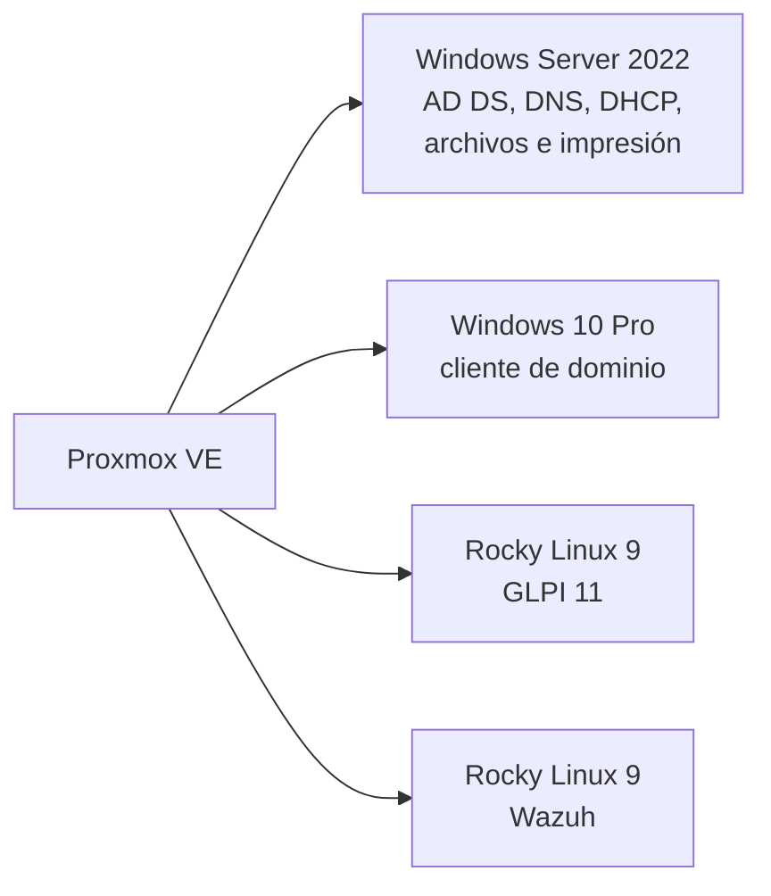
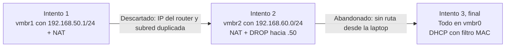
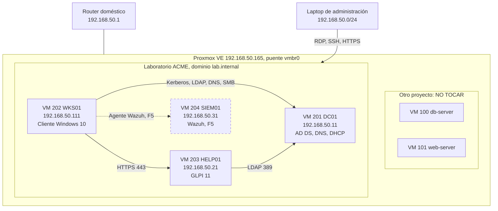
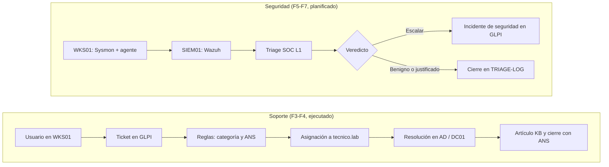
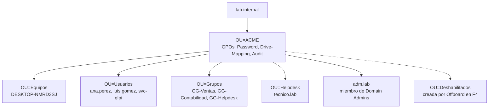
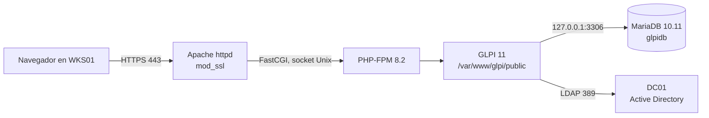
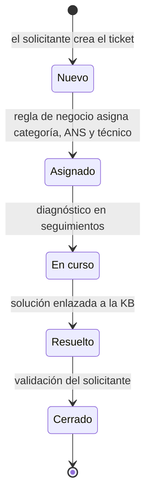
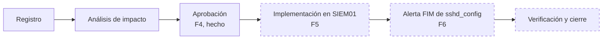
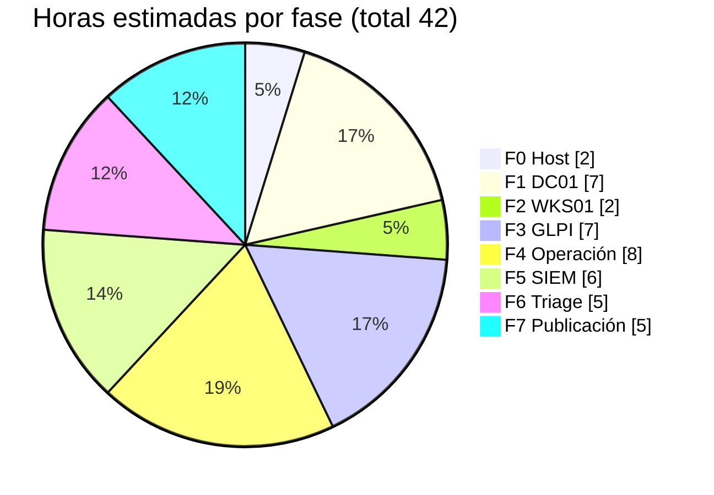

<div align="center">

# Rocky Help Desk & SOC Lab

**Informe técnico de implementación: soporte técnico y SOC L1 sobre Proxmox VE**


**Autor:** Abelardo Cárcamo Barría &nbsp;|&nbsp; **Última actualización:** 25 de noviembre de 2026

</div>

---

> [!NOTE]
> Este documento es la **versión 1.0 del informe técnico**. Documenta paso a paso lo ejecutado en las fases F0 a F4 y deja especificadas las fases F5 a F7, que aún no se han ejecutado. La versión de publicación del repositorio (`v1.0.0`) se etiqueta al cerrar F7. El informe no incluye resultados inventados de fases no ejecutadas.

## Tabla de contenido

| Sección | Contenido |
|---|---|
| [Resumen del proyecto](#resumen-del-proyecto) | Tesis, pila tecnológica, estado por fase y alcance |
| [Arquitectura](#arquitectura) | Host, red, máquinas virtuales, perfiles de memoria y diagramas |
| [Repositorio y estándares](#repositorio-y-estándares) | Estructura, capturas e higiene de secretos |
| [F0: Preparación del host Proxmox](#f0-preparación-del-host-proxmox) | Diagnóstico, ISOs y VMs base |
| [F1: DC01 con AD DS, DNS, DHCP, GPO e impresión](#f1-dc01-con-ad-ds-dns-dhcp-gpo-e-impresión) | Controlador de dominio y servicios de red |
| [F2: WKS01, equipo cliente](#f2-wks01-equipo-cliente) | Cliente Windows unido al dominio |
| [F3: HELP01, mesa de ayuda con GLPI 11](#f3-help01-mesa-de-ayuda-con-glpi-11) | GLPI, LDAP, ITIL y ANS |
| [F4: Operación de soporte, cambios y respaldos](#f4-operación-de-soporte-cambios-y-respaldos) | 8 tickets, scripts, CHG-001 y restauración |
| [F5 a F7: SIEM, triage SOC L1 y publicación](#f5-a-f7-siem-triage-soc-l1-y-publicación) | Fases planificadas |
| [Criterios de aceptación](#criterios-de-aceptación) | Lista de verificación del proyecto |
| [Problemas frecuentes y soluciones](#problemas-frecuentes-y-soluciones) | Errores reales y previsibles por fase |
| [Limitaciones y alternativas para producción](#limitaciones-y-alternativas-para-producción) | Contenido base de `limitaciones.md` |
| [Apéndice A: Capturas de evidencia](#apéndice-a-capturas-de-evidencia) | Cómo añadir capturas y lista completa |
| [Apéndice B: Historial del documento](#apéndice-b-historial-del-documento) | Versiones y cambios |

---

## Resumen del proyecto

**Tesis.** Operar la TI de una pyme ficticia (ACME): atender incidencias con un sistema de tickets (GLPI) y vigilar la seguridad de sus equipos con un SIEM (Wazuh), todo documentado y reproducible desde cero.

**Pila tecnológica.**



**Alcance de este informe.** Documenta lo ejecutado en las fases F0 a F4 (comandos, decisiones, errores encontrados y sus correcciones) y deja especificadas las fases F5 a F7 (SIEM, triage SOC L1, escalamiento y publicación), cuyos comandos se añadirán al ejecutarlas y verificarlas.

> [!IMPORTANT]
> **Convención de seguridad.** Todas las contraseñas se piden con `Read-Host -AsSecureString` o se generan en variables. Ninguna contraseña real del laboratorio debe versionarse en el repositorio.

### Estado por fase

| Fase | Descripción | Estado |
|---|---|---|
| F0 | Preparación del host Proxmox, ISOs y VMs base |  |
| F1 | DC01: AD DS, DNS, DHCP, GPO, archivos e impresión |  |
| F2 | WKS01: cliente Windows unido al dominio |  |
| F3 | HELP01: GLPI 11 sobre Rocky Linux 9, LDAP, ITIL y ANS |  |
| F4 | Operación: 8 tickets, scripts, respaldos, cambio CHG-001 |  (CHG-001 aprobado; ejecución técnica en F5) |
| F5 | SIEM01: Wazuh, agente, Sysmon, regla propia, FIM |  |
| F6 | Triage SOC L1 de 6 alertas |  |
| F7 | Escalamientos, documentación final y publicación v1.0.0 |  |

### Qué demuestra el proyecto

| Competencia | Evidencia en el laboratorio | Fase |
|---|---|---|
| Soporte técnico y tickets | 8 tickets resueltos en GLPI con categoría, prioridad, ANS y artículo de base de conocimiento (KB) | F3-F4 |
| Cuentas y accesos | Active Directory con OUs y grupos, delegación al Helpdesk con mínimo privilegio, scripts de alta y baja en PowerShell | F1, F4 |
| Servicios de red | DHCP, DNS y diagnóstico documentado de una falla de red | F1, F4 |
| Equipos e impresoras | Cliente Windows, servidor de impresión, diagnóstico de equipo lento | F2, F4 |
| Seguridad, respaldos y actualizaciones | Política de contraseñas y bloqueo de dominio, GPO de auditoría, SELinux en Enforcing, firewalld, respaldos con prueba de restauración | F1, F3, F4 |
| Documentación y reportes | Runbook, base de conocimiento, README, bitácora de triage | F4, F7 |
| SOC L1 | Wazuh con Sysmon, 1 regla personalizada, 6 alertas con veredicto, tiempo de triage y escalamiento | F5-F6 |
| Gestión de cambios | Registro CHG-001 con plan y reversa, enlazado a una alerta real del SIEM | F4-F6 |

### Fuera de alcance (a propósito)

Correo electrónico, WSUS, LDAPS con ADCS, integración automática Wazuh → GLPI, alta disponibilidad y hardware físico. Todo se documenta en [`limitaciones.md`](limitaciones.md) junto con las alternativas para producción (ver [Limitaciones](#limitaciones-y-alternativas-para-producción)).

<p align="right"><a href="#rocky-help-desk--soc-lab">Volver arriba</a></p>

---

## Arquitectura

### Host y red real

| Elemento | Valor |
|---|---|
| Host | Proxmox VE sobre Intel Core i5 de 5.ª generación, 8 GB de RAM |
| NIC y puente | `enp0s25` en el puente `vmbr0` |
| IP del host | `192.168.50.165/24` |
| Puerta de enlace | `192.168.50.1` (router doméstico) |
| Acceso remoto | Tailscale activo en el host (`tailscale0`) |
| Equipo de administración | Laptop en el mismo segmento `192.168.50.0/24` |
| VMs preexistentes | VMID 100 `db-server` y VMID 101 `web-server` (Rocky Linux, proyecto aparte) |

> [!CAUTION]
> **Restricción dura:** la LAN `192.168.50.0/24` ya aloja las VMs 100 y 101 de otro proyecto. No se debe alterar su enrutamiento en ningún paso del laboratorio.

### Decisión de red y su historial

La red del laboratorio cambió tres veces. El historial se conserva porque explica varios errores del apartado de [problemas frecuentes](#problemas-frecuentes-y-soluciones).



| Intento | Diseño | Resultado |
|---|---|---|
| 1 | Puente aislado `vmbr1` con `192.168.50.1/24` + NAT (diseño original) | **Descartado antes de aplicarlo.** La IP `192.168.50.1` es la del router real y la subred duplicaba la LAN. Habría roto el enrutamiento de los Rocky existentes. |
| 2 | Puente aislado `vmbr2` con `192.168.60.0/24`, NAT hacia `vmbr0` y regla `DROP` hacia `192.168.50.0/24` | Creado y verificado sin afectar rutas. **Abandonado:** la laptop está en `.50`, no hay ruta hacia `.60` y se necesitaba RDP con copiar y pegar. |
| 3 (final) | Todo el laboratorio en `vmbr0`, IPs `192.168.50.11 / .21 / .31 / .111`, DHCP restringido por filtro MAC | **En producción.** Se pierde el aislamiento del laboratorio (documentado en [Limitaciones](#limitaciones-y-alternativas-para-producción)). |

> [!WARNING]
> Antes de crear VMs, verificar que las direcciones del laboratorio (`.11`, `.21`, `.31`, `.111` y el rango DHCP `.100`-`.150`) no se solapen con las VMs preexistentes ni con el rango DHCP del router.

### Máquinas virtuales

| VMID | Nombre | Sistema | vCPU | RAM | Disco | IP | Rol |
|---|---|---|---|---|---|---|---|
| 201 | DC01 | Windows Server 2022 Standard (Evaluation) | 2 | 2 GB | 40 + 10 GB | `192.168.50.11` | AD DS, DNS, DHCP, archivos, impresión, respaldo |
| 202 | WKS01 | Windows 10 Pro | 2 | 2 GB | 40 GB | `192.168.50.111` (reserva) | Cliente de dominio; hostname actual `DESKTOP-NMRD3SJ` |
| 203 | HELP01 | Rocky Linux 9 | 1 | 1 GB (2 GB solo al instalar) | 20 GB | `192.168.50.21` | GLPI 11 + MariaDB 10.11 + Apache + PHP 8.2 |
| 204 | SIEM01 | Rocky Linux 9 | 2 | 4 GB | 40 GB | `192.168.50.31` | Wazuh (F5) |

### Perfiles de memoria

Con 8 GB físicos nunca se encienden las cuatro VMs a la vez, y las VMs 100 y 101 permanecen apagadas durante el laboratorio.

| Perfil | VMs encendidas | RAM asignada | Fases |
|---|---|---|---|
| **A (soporte)** | DC01 + WKS01 + HELP01 | 2 + 2 + 1 = **5 GB** | F1 a F4 y F7 |
| **B (SOC)** | SIEM01 + WKS01 | 4 + 2 = **6 GB** | F5 y F6 |

> [!NOTE]
> En el perfil B el controlador de dominio está apagado, por lo que los eventos de seguridad se generan localmente en WKS01.

### Convenciones

| Elemento | Valor |
|---|---|
| Dominio | `lab.internal` (NetBIOS `LAB`) |
| Organización ficticia | ACME |
| Administrador de dominio | `adm.lab` |
| Técnico Helpdesk | `tecnico.lab` |
| Cuenta de servicio LDAP | `svc-glpi` |
| Usuarios finales | `ana.perez` (Ventas), `luis.gomez` (Contabilidad) |
| Grupos globales | `GG-Ventas`, `GG-Contabilidad`, `GG-Helpdesk` |
| Zona horaria | `America/Panama` (Linux) y `SA Pacific Standard Time` (Windows) |

### Diagrama lógico



### Flujos de operación



<p align="right"><a href="#rocky-help-desk--soc-lab">Volver arriba</a></p>

---

## Repositorio y estándares

### Estructura del repositorio

```text
rocky-helpdesk-soc-lab/
├── README.md
├── README.es.md
├── .gitignore
├── docs/
│   ├── INFORME-TECNICO.md          <- este documento
│   ├── limitaciones.md
│   ├── arquitectura/ARQUITECTURA.md
│   ├── runbook/RUNBOOK.md
│   ├── soporte/
│   │   ├── kb/KB-INDEX.md
│   │   ├── tickets/TKT-001.md ... TKT-008.md
│   │   └── cambios/CHG-001.md
│   └── soc/
│       ├── TRIAGE-LOG.md
│       ├── PLAYBOOK.md
│       └── reglas/
├── scripts/
│   ├── windows/Onboard-Usuarios.ps1
│   ├── windows/Offboard-Usuario.ps1
│   └── linux/backup-glpi.sh
├── config/
│   ├── dc01/  wks01/  help01/
│   └── siem01/local_rules.xml
└── evidencia/
    ├── F0/ F1/ F2/ F3/ F4/ F5/ F6/ F7/
    └── global/
```

### Crear la estructura en la PC de trabajo

<details>
<summary><b>Script de PowerShell para crear carpetas, archivos base, <code>.gitignore</code> y el repositorio Git</b></summary>

```powershell
$root = "$HOME\Documents\rocky-helpdesk-soc-lab"
$dirs = @(
 "docs\runbook","docs\soporte\kb","docs\soporte\tickets","docs\soporte\cambios",
 "docs\soc\reglas","docs\arquitectura",
 "scripts\windows","scripts\linux",
 "config\dc01","config\wks01","config\help01","config\siem01",
 "evidencia\F0","evidencia\F1","evidencia\F2","evidencia\F3",
 "evidencia\F4","evidencia\F5","evidencia\F6","evidencia\F7","evidencia\global"
)
$dirs | % { New-Item -ItemType Directory -Force -Path "$root\$_" | Out-Null }

$files = @(
 "README.md","README.es.md",
 "docs\INFORME-TECNICO.md","docs\limitaciones.md","docs\runbook\RUNBOOK.md",
 "docs\soporte\kb\KB-INDEX.md","docs\soporte\cambios\CHG-001.md",
 "docs\soc\TRIAGE-LOG.md","docs\soc\PLAYBOOK.md",
 "docs\arquitectura\ARQUITECTURA.md",
 "scripts\windows\Onboard-Usuarios.ps1","scripts\windows\Offboard-Usuario.ps1",
 "scripts\linux\backup-glpi.sh",
 "config\siem01\local_rules.xml"
)
$files | % { New-Item -ItemType File -Force -Path "$root\$_" | Out-Null }
1..8 | % { New-Item -ItemType File -Force -Path ("$root\docs\soporte\tickets\TKT-{0:D3}.md" -f $_) | Out-Null }
Get-ChildItem "$root\evidencia","$root\config" -Directory -Recurse |
 % { New-Item -ItemType File -Force -Path "$($_.FullName)\.gitkeep" | Out-Null }

@'
*.key
*.pem
*.pfx
*.env
.env
id_rsa*
*.ppk
*.sql
*.sql.gz
*.bak
*.iso
*.qcow2
*.vma*
*.kdbx
*password*
*secret*
*credential*
Thumbs.db
'@ | Set-Content "$root\.gitignore" -Encoding utf8

Set-Location $root; git init; git branch -M main
```

</details>

> [!TIP]
> Los archivos `.gitkeep` permiten versionar las carpetas `evidencia/F<n>/` vacías. Así las rutas de las capturas ya existen en GitHub antes de subir las imágenes.

### Estándar de capturas de pantalla

| Regla | Detalle |
|---|---|
| Formato | PNG, 1280x720 |
| Procedencia | `hostname` y fecha/hora visibles en la misma pantalla (`date` en Linux, `Get-Date` en Windows) |
| Anotaciones | Solo rectángulos rojos |
| Censura | Rectángulos negros sólidos, **nunca** desenfoque (contraseñas, claves, redes personales, MAC reales si se desea) |
| Nombre | `F<n>-<NN>-<descripcion>.png` dentro de `evidencia/F<n>/` |
| Incorporación | Ver [Apéndice A](#apéndice-a-capturas-de-evidencia) |

### Higiene de secretos

- No versionar contraseñas, cadenas de conexión, claves privadas ni volcados de base de datos (`.gitignore` estricto).
- En `config/` exportar solo configuraciones saneadas (sin contraseñas ni hashes).
- Antes de publicar (F7), `gitleaks detect --source . -v` debe terminar sin hallazgos.
- El script de alta imprime la contraseña temporal en consola y **no** la escribe en el log.

<p align="right"><a href="#rocky-help-desk--soc-lab">Volver arriba</a></p>

---

## F0: Preparación del host Proxmox

| Duración estimada | VMs encendidas | Objetivo |
|---|---|---|
| 2 horas | Ninguna | Inventariar el host, descargar ISOs y crear las 4 VMs base sin alterar la red existente |

### Diagnóstico previo (solo lectura)

Ejecutar antes de cualquier cambio. No modifica nada y evitó colisiones de red y de VMID en este proyecto.

```bash
hostname; date
ip -br a
ip route
grep -n "vmbr\|address\|bridge-ports" /etc/network/interfaces
iptables -t nat -S POSTROUTING
cat /proc/sys/net/ipv4/ip_forward
pve-firewall status
qm list
for i in $(qm list | awk 'NR>1{print $1}'); do echo "== $i"; qm config $i | grep -E "^name|^net"; done
```

**Hallazgos del host:**

| Elemento | Resultado |
|---|---|
| `vmbr0` | `192.168.50.165/24` |
| Ruta por defecto | Vía `192.168.50.1` |
| Cadena NAT | Solo `ts-postrouting` (Tailscale) |
| VMs existentes | 100 (`db-server`) y 101 (`web-server`), ambas en `vmbr0` |
| Puentes adicionales | No existían `vmbr1` ni `vmbr2` |

> [!IMPORTANT]
> Consecuencias del diagnóstico: el diseño original (`vmbr1` con `192.168.50.1/24`) se descartó, y los VMID 101-104 del documento original se sustituyeron por **201-204** porque el 101 ya estaba en uso.

### Historial: puente aislado vmbr2 (intento 2)

Se documenta porque deja reglas en el host. Se creó **sin** `ifreload -a` (que recarga todas las interfaces), levantando solo el puente nuevo.

<details>
<summary><b>Creación de vmbr2 (histórico)</b></summary>

```bash
cp /etc/network/interfaces /etc/network/interfaces.bak.$(date +%F-%H%M)
cat >> /etc/network/interfaces <<'EOF'

auto vmbr2
iface vmbr2 inet static
    address 192.168.60.1/24
    bridge-ports none
    bridge-stp off
    bridge-fd 0
    post-up   echo 1 > /proc/sys/net/ipv4/ip_forward
    post-up   iptables -t nat -A POSTROUTING -s 192.168.60.0/24 -o vmbr0 -j MASQUERADE
    post-up   iptables -I FORWARD 1 -s 192.168.60.0/24 -d 192.168.50.0/24 -j DROP
    post-down iptables -t nat -D POSTROUTING -s 192.168.60.0/24 -o vmbr0 -j MASQUERADE
    post-down iptables -D FORWARD -s 192.168.60.0/24 -d 192.168.50.0/24 -j DROP
EOF
ifup vmbr2
ip -br a show vmbr2; iptables -t nat -S POSTROUTING; iptables -S FORWARD | head -5; ip route
```

</details>

**Limpieza (si el puente sigue definido).** Todas las VMs del laboratorio ya usan `vmbr0`, así que se puede retirar:

```bash
ifdown vmbr2
cp /etc/network/interfaces /etc/network/interfaces.pre-cleanup
nano /etc/network/interfaces     # borrar el bloque completo 'auto vmbr2'
ip -br a
iptables -t nat -S POSTROUTING
iptables -S FORWARD | head
ip route
```

**Resultado esperado:** `ts-postrouting` intacto, sin reglas de `192.168.60.0/24` y `default via 192.168.50.1 dev vmbr0` sin cambios.

### ISOs

```bash
cd /var/lib/vz/template/iso
wget https://download.rockylinux.org/pub/rocky/9/isos/x86_64/Rocky-9-latest-x86_64-minimal.iso
wget https://fedorapeople.org/groups/virt/virtio-win/direct-downloads/stable-virtio/virtio-win.iso
ls -lh
pvesm status
```

| ISO | Origen | Método |
|---|---|---|
| Rocky Linux 9 minimal | rockylinux.org | `wget` en el host |
| virtio-win | Fedora (repositorio oficial de drivers virtio para Windows) | `wget` en el host |
| Windows Server 2022 | Microsoft Evaluation Center | GUI: `local > ISO Images > Upload` |
| Windows 10 | Microsoft | GUI: `local > ISO Images > Upload` |

Sin la ISO `virtio-win` el instalador de Windows no ve los dispositivos virtuales (disco, red, balloon). Almacenamiento: `local` para ISOs y `local-lvm` para discos de VM.

Verificación opcional del contenido de virtio-win desde el host (no afecta VMs en ejecución):

```bash
mkdir -p /mnt/virtio-check
mount -o loop,ro /var/lib/vz/template/iso/virtio-win.iso /mnt/virtio-check
ls /mnt/virtio-check/vioscsi/ /mnt/virtio-check/NetKVM/
umount /mnt/virtio-check
```

### Creación de las VMs base

Ajustar los nombres de ISO con `ls` y el almacenamiento con `pvesm status`. Todas las VMs usan `vmbr0` (decisión final de red).

```bash
# DC01 - Windows Server 2022
qm create 201 --name DC01 --ostype win10 --memory 2048 --cores 2 --cpu host \
 --net0 virtio,bridge=vmbr0 --scsihw virtio-scsi-single \
 --scsi0 local-lvm:40 --scsi1 local-lvm:10 \
 --ide2 local:iso/SERVER_EVAL_x64FRE_en-us.iso,media=cdrom \
 --ide0 local:iso/virtio-win.iso,media=cdrom \
 --boot 'order=ide2;scsi0' --agent enabled=1 --onboot 0

# WKS01 - Windows 10
qm create 202 --name WKS01 --ostype win10 --memory 2048 --cores 2 --cpu host \
 --net0 virtio,bridge=vmbr0 --scsihw virtio-scsi-single --scsi0 local-lvm:40 \
 --ide2 local:iso/Win10_x64.iso,media=cdrom \
 --ide0 local:iso/virtio-win.iso,media=cdrom \
 --boot 'order=ide2;scsi0' --agent enabled=1 --onboot 0

# HELP01 - Rocky 9 (2 GB solo durante la instalacion)
qm create 203 --name HELP01 --ostype l26 --memory 2048 --cores 1 --cpu host \
 --net0 virtio,bridge=vmbr0 --scsihw virtio-scsi-single --scsi0 local-lvm:20 \
 --ide2 local:iso/Rocky-9-latest-x86_64-minimal.iso,media=cdrom \
 --boot 'order=ide2;scsi0' --agent enabled=1 --onboot 0

# SIEM01 - Rocky 9
qm create 204 --name SIEM01 --ostype l26 --memory 4096 --cores 2 --cpu host \
 --net0 virtio,bridge=vmbr0 --scsihw virtio-scsi-single --scsi0 local-lvm:40 \
 --ide2 local:iso/Rocky-9-latest-x86_64-minimal.iso,media=cdrom \
 --boot 'order=ide2;scsi0' --agent enabled=1 --onboot 0

qm list
for i in 201 202 203 204; do qm config $i | grep -E "^name|^net0|^memory|^scsi"; done
```

> [!CAUTION]
> **Regla de oro de almacenamiento:** tras instalar Windows con el driver `vioscsi`, **nunca cambiar el tipo de controlador** del disco (por ejemplo de `scsi0` a `virtio0`). Windows deja de encontrar su volumen y los discos aparecen sin conexión. En este proyecto la única salida fue destruir y recrear la VM.

<details>
<summary><b>Evidencia F0</b>: capturas F0-01 a F0-07</summary>

Detalle de cada captura en el [Apéndice A](#apéndice-a-capturas-de-evidencia).

<!--  -->
<!--  -->
<!--  -->
<!--  -->
<!--  -->
<!--  -->
<!--  -->

</details>

<p align="right"><a href="#rocky-help-desk--soc-lab">Volver arriba</a></p>

---

## F1: DC01 con AD DS, DNS, DHCP, GPO e impresión

| Duración estimada | VMs encendidas | Objetivo |
|---|---|---|
| 7 horas | DC01 (más WKS01 al verificar) | Controlador de dominio `lab.internal` con servicios de red, estructura de AD, GPOs, archivos e impresión |

### Instalación de Windows Server 2022

1. Arrancar la VM y abrir la consola (`VM 201 > Console`). Elegir **Windows Server 2022 Standard Evaluation (Desktop Experience)**.
2. En «¿Dónde desea instalar Windows?», si no aparece el disco: **Load driver** → CD virtio-win → `vioscsi\2k22\amd64`. El controlador es virtio-scsi, no virtio-blk: `viostor` y `NetKVM` no sirven en esta pantalla. Si no existe la carpeta `2k22`, usar `2k19\amd64`.
3. Terminar la instalación y definir la contraseña del Administrador local (se convertirá en la del Administrador de dominio al promover el DC).
4. Tras el primer arranque, ejecutar `virtio-win-guest-tools.exe` desde el CD (NIC, balloon, agente) y reiniciar.

La consola noVNC de Proxmox no permite copiar y pegar de forma fiable. Para ejecutar los bloques de comandos con portapapeles se habilita RDP y se trabaja desde la laptop (por eso DC01 debe estar en el mismo segmento; ver [historial de red](#decisión-de-red-y-su-historial)).

```powershell
Set-ItemProperty 'HKLM:\System\CurrentControlSet\Control\Terminal Server' -Name fDenyTSConnections -Value 0
Enable-NetFirewallRule -DisplayGroup "Remote Desktop"
Set-TimeZone -Id "SA Pacific Standard Time"
```

### Red, nombre y promoción a controlador de dominio

```powershell
Get-NetAdapter
New-NetIPAddress -InterfaceAlias "Ethernet" -IPAddress 192.168.50.11 -PrefixLength 24 -DefaultGateway 192.168.50.1
Set-DnsClientServerAddress -InterfaceAlias "Ethernet" -ServerAddresses 127.0.0.1
Rename-Computer -NewName "DC01" -Restart
```

Tras el reinicio, instalar los roles y promover el bosque `lab.internal`:

```powershell
Install-WindowsFeature -Name AD-Domain-Services,DNS -IncludeManagementTools
Import-Module ADDSDeployment
$dsrm = Read-Host "Contrasena DSRM (modo restauracion)" -AsSecureString
Install-ADDSForest `
  -DomainName "lab.internal" `
  -DomainNetbiosName "LAB" `
  -InstallDns:$true `
  -SafeModeAdministratorPassword $dsrm `
  -Force:$true
```

El servidor se reinicia solo. Iniciar sesión como `LAB\Administrator` con la contraseña del Administrador local anterior y verificar:

```powershell
hostname; Get-Date
Get-ADDomain | Select-Object Name,NetBIOSName,DomainMode,PDCEmulator
Get-Service NTDS,DNS,Netlogon | Select-Object Name,Status
dcdiag /q
```

### DHCP con filtro MAC y registro DNS

> [!WARNING]
> **Riesgo en LAN real:** un servidor DHCP autorizado con el ámbito activo en `192.168.50.0/24` compite con el router y puede entregar concesiones (con DNS `192.168.50.11`) a cualquier dispositivo de la casa. Se mitiga con el filtro de direcciones MAC en modo Allow: solo los equipos del laboratorio reciben concesión. **Habilitar el filtro antes de activar el ámbito.**

```powershell
Install-WindowsFeature DHCP -IncludeManagementTools
netsh dhcp add securitygroups
Restart-Service DHCPServer

# Filtro: solo MACs permitidas reciben concesion
Set-DhcpServerv4FilterList -Allow $true -Deny $false
Add-DhcpServerv4Filter -List Allow -MacAddress "<MAC-WKS01>" -Description "WKS01"
Get-DhcpServerv4FilterList

# Ambito, opciones y autorizacion
Add-DhcpServerv4Scope -Name "LAB-Scope" -StartRange 192.168.50.100 -EndRange 192.168.50.150 -SubnetMask 255.255.255.0 -State Active
Set-DhcpServerv4OptionValue -ScopeId 192.168.50.0 -Router 192.168.50.1 -DnsServer 192.168.50.11 -DnsDomain "lab.internal"
Add-DhcpServerInDC -DnsName "DC01.lab.internal" -IPAddress 192.168.50.11

# Reserva para WKS01 (MAC: qm config 202 | grep net0 en el host)
Add-DhcpServerv4Reservation -ScopeId 192.168.50.0 -IPAddress 192.168.50.111 -ClientId "<MAC-WKS01>" -Name "WKS01"
Get-DhcpServerv4Reservation -ScopeId 192.168.50.0

# Registro DNS de la mesa de ayuda
Add-DnsServerResourceRecordA -Name "help01" -ZoneName "lab.internal" -IPv4Address 192.168.50.21
Get-DnsServerResourceRecord -ZoneName "lab.internal" -RRType A
```

`<MAC-WKS01>` se obtiene en el host con `qm config 202 | grep net0` (valor tras `virtio=`). `Add-DhcpServerv4Reservation` acepta la MAC con o sin guiones y la normaliza en minúsculas con guiones.

> [!TIP]
> Si los clientes no resuelven nombres de Internet, añadir un reenviador hacia el router: `Add-DnsServerForwarder -IPAddress 192.168.50.1`.

### Estructura de Active Directory



La contraseña inicial se pide una sola vez y se reutiliza:

```powershell
Import-Module ActiveDirectory
$base = "DC=lab,DC=internal"
$pw = Read-Host "Contrasena inicial de usuarios del laboratorio" -AsSecureString

New-ADOrganizationalUnit -Name "ACME"     -Path $base
New-ADOrganizationalUnit -Name "Equipos"  -Path "OU=ACME,$base"
New-ADOrganizationalUnit -Name "Usuarios" -Path "OU=ACME,$base"
New-ADOrganizationalUnit -Name "Grupos"   -Path "OU=ACME,$base"
New-ADOrganizationalUnit -Name "Helpdesk" -Path "OU=ACME,$base"

New-ADGroup -Name "GG-Ventas"       -GroupScope Global -Path "OU=Grupos,OU=ACME,$base"
New-ADGroup -Name "GG-Contabilidad" -GroupScope Global -Path "OU=Grupos,OU=ACME,$base"
New-ADGroup -Name "GG-Helpdesk"     -GroupScope Global -Path "OU=Grupos,OU=ACME,$base"

$users = @(
 @{n="ana.perez";   p="OU=Usuarios,OU=ACME,$base"},
 @{n="luis.gomez";  p="OU=Usuarios,OU=ACME,$base"},
 @{n="svc-glpi";    p="OU=Usuarios,OU=ACME,$base"},
 @{n="tecnico.lab"; p="OU=Helpdesk,OU=ACME,$base"},
 @{n="adm.lab";     p="OU=ACME,$base"}
)
foreach ($u in $users) {
  New-ADUser -Name $u.n -SamAccountName $u.n -UserPrincipalName "$($u.n)@lab.internal" `
    -Path $u.p -AccountPassword $pw -Enabled $true
}

Add-ADGroupMember -Identity "GG-Ventas"       -Members ana.perez
Add-ADGroupMember -Identity "GG-Contabilidad" -Members luis.gomez
Add-ADGroupMember -Identity "GG-Helpdesk"     -Members tecnico.lab
Add-ADGroupMember -Identity "Domain Admins"   -Members adm.lab

# Cuenta de servicio de GLPI: evita que la sincronizacion LDAP falle al vencer la contrasena (90 dias)
Set-ADUser svc-glpi -PasswordNeverExpires $true

Get-ADOrganizationalUnit -Filter * -SearchBase "OU=ACME,$base" | Select-Object Name
Get-ADUser -Filter * -SearchBase "OU=ACME,$base" | Select-Object Name,DistinguishedName
Get-ADGroupMember -Identity "Domain Admins" | Select-Object Name
```

> [!NOTE]
> `New-ADUser` y `Add-ADGroupMember` no producen salida cuando funcionan. Verificar siempre con los `Get-AD*` posteriores.

### Delegación de mínimo privilegio al Helpdesk

`GG-Helpdesk` solo puede restablecer contraseñas y desbloquear cuentas de usuario dentro de `OU=ACME`.

| Acción | Permiso delegado |
|---|---|
| Restablecer contraseña | Derecho extendido *Reset Password* |
| Forzar cambio en el siguiente inicio de sesión | Lectura y escritura de `pwdLastSet` |
| Desbloquear cuenta | Lectura y escritura de `lockoutTime` (no es un derecho extendido) |

```powershell
dsacls "OU=ACME,DC=lab,DC=internal" /I:S /G `
 "LAB\GG-Helpdesk:CA;Reset Password;user" `
 "LAB\GG-Helpdesk:WP;lockoutTime;user" "LAB\GG-Helpdesk:RP;lockoutTime;user" `
 "LAB\GG-Helpdesk:WP;pwdLastSet;user"   "LAB\GG-Helpdesk:RP;pwdLastSet;user"
dsacls "OU=ACME,DC=lab,DC=internal" | Select-String "GG-Helpdesk"
```

> [!WARNING]
> **Error corregido durante el proyecto:** una primera delegación usó un GUID inventado para «Unlock Account» (`00000000-0000-0000-0000-000000000800`). Windows lo aceptó sin error pero era ineficaz, y el desbloqueo del TKT-002 habría fallado. Si existe esa ACE, retirarla con el bloque siguiente.

```powershell
$p = "AD:OU=ACME,DC=lab,DC=internal"
$acl = Get-Acl $p
$acl.Access | ? { $_.ObjectType -eq [guid]'00000000-0000-0000-0000-000000000800' } | % { [void]$acl.RemoveAccessRule($_) }
Set-Acl $p $acl
```

### Política de contraseñas y bloqueo de dominio

Las políticas de contraseña y de bloqueo de **cuentas de dominio** solo se aplican a nivel de dominio. Una GPO vinculada a una OU no las modifica; por eso se fijan con el cmdlet específico.

```powershell
Set-ADDefaultDomainPasswordPolicy -Identity lab.internal `
  -MinPasswordLength 12 -ComplexityEnabled $true -MaxPasswordAge 90.00:00:00 -PasswordHistoryCount 12 `
  -LockoutThreshold 5 -LockoutDuration 00:30:00 -LockoutObservationWindow 00:30:00
Get-ADDefaultDomainPasswordPolicy
```

| Parámetro | Valor |
|---|---|
| Longitud mínima | 12 caracteres |
| Complejidad | Habilitada |
| Vigencia máxima | 90 días |
| Historial | 12 contraseñas |
| Umbral de bloqueo | 5 intentos |
| Duración del bloqueo y ventana de observación | 30 minutos |

### GPOs

Se crean tres GPOs y se vinculan a `OU=ACME`. Los equipos deben residir en una OU bajo `ACME` para recibirlas.

```powershell
Import-Module GroupPolicy
New-GPO -Name "ACME-Password-Policy" -Comment "Endurecimiento de equipos: cambio de contrasena de cuenta de equipo cada 90 dias"
Set-GPRegistryValue -Name "ACME-Password-Policy" -Key "HKLM\System\CurrentControlSet\Services\Netlogon\Parameters" -ValueName "MaximumPasswordAge" -Type DWord -Value 90
New-GPO -Name "ACME-Drive-Mapping" -Comment "Mapea V: a \\DC01\ACME-Share"
New-GPO -Name "ACME-Audit-Policy"  -Comment "Auditoria avanzada de seguridad"

"ACME-Password-Policy","ACME-Drive-Mapping","ACME-Audit-Policy" | % {
  New-GPLink -Name $_ -Target "OU=ACME,DC=lab,DC=internal" | Out-Null
}
Get-GPInheritance -Target "OU=ACME,DC=lab,DC=internal"
```

| GPO | Ámbito | Propósito |
|---|---|---|
| `ACME-Password-Policy` | Equipo | Cambio de contraseña de la **cuenta de equipo** cada 90 días (no controla las contraseñas de usuario) |
| `ACME-Drive-Mapping` | Usuario | Unidad `V:` hacia `\\DC01\ACME-Share` |
| `ACME-Audit-Policy` | Equipo | Auditoría avanzada, necesaria para F5-F6 |

> [!NOTE]
> `Get-GPLink` no existe; los vínculos se verifican con `Get-GPInheritance` (campo `GpoLinks`). Un GPO recién creado con `New-GPO` queda en versión 0 y **no aplica nada** hasta configurar sus directivas en `gpmc.msc`.

#### ACME-Drive-Mapping (usuario)

- Ruta: `User Configuration > Preferences > Windows Settings > Drive Maps > New > Mapped Drive`.
- Action `Create`, ubicación `\\DC01\ACME-Share`, Reconnect activado, etiqueta `ACME-Share`, letra `V`.

#### ACME-Audit-Policy (equipo)

Ruta base: `Computer Configuration > Policies > Windows Settings > Security Settings > Advanced Audit Policy Configuration`.

| Categoría | Subcategoría | Auditar |
|---|---|---|
| Logon/Logoff | Logon | Éxito y error |
| Logon/Logoff | Account Lockout | Error |
| Account Management | User Account Management | Éxito y error |
| Account Management | Security Group Management | Éxito y error |
| Detailed Tracking | Process Creation | Éxito |

Ajustes complementarios:

- `Administrative Templates > System > Audit Process Creation > Include command line in process creation events` = **Enabled**.
- `Local Policies > Security Options > Audit: Force audit policy subcategory settings` = **Enabled**.

```powershell
# En el cliente, tras mover el equipo a la OU correcta:
gpupdate /force
gpresult /h C:\gpresult.html
```

### Carpeta compartida con permisos por departamento

```powershell
$r = "C:\ACME-Share"
New-Item -ItemType Directory -Path $r -Force | Out-Null
New-SmbShare -Name "ACME-Share" -Path $r -FullAccess "LAB\Domain Admins","LAB\GG-Helpdesk" -ChangeAccess "LAB\Domain Users"
icacls $r /grant "LAB\Domain Users:(CI)(OI)M"
icacls $r /grant "LAB\GG-Helpdesk:(CI)(OI)F"

"Ventas","Contabilidad","Comun" | % { New-Item -ItemType Directory -Force "$r\$_" | Out-Null }
icacls "$r\Ventas" /inheritance:r /grant "BUILTIN\Administrators:(OI)(CI)F" /grant "NT AUTHORITY\SYSTEM:(OI)(CI)F" /grant "LAB\GG-Ventas:(OI)(CI)M"
icacls "$r\Contabilidad" /inheritance:r /grant "BUILTIN\Administrators:(OI)(CI)F" /grant "NT AUTHORITY\SYSTEM:(OI)(CI)F" /grant "LAB\GG-Contabilidad:(OI)(CI)M"
"informe ventas Q4" | Set-Content "$r\Ventas\informe-ventas.txt"
"balance Q4" | Set-Content "$r\Contabilidad\balance.txt"

Get-SmbShare -Name "ACME-Share"
icacls "$r\Ventas"; icacls "$r\Contabilidad"
```

| Carpeta | Herencia | Acceso |
|---|---|---|
| `Ventas` | Rota | `GG-Ventas` (Modify), Administradores y SYSTEM |
| `Contabilidad` | Rota | `GG-Contabilidad` (Modify), Administradores y SYSTEM |
| `Comun` | Heredada | `Domain Users` (Modify) |

Esta estructura permite reproducir de forma realista el ticket «Acceso denegado a carpeta compartida» (TKT-001).

> [!CAUTION]
> `GG-Helpdesk` recibe control total en el recurso y en la raíz de la carpeta, más de lo que necesita según el principio de mínimo privilegio aplicado en la delegación de AD. En producción bastaría con `-ChangeAccess` y permisos `M` en NTFS. Se mantiene así en el laboratorio por fidelidad con lo ejecutado.

### Impresora compartida

El driver `Microsoft Print to PDF` no existe en Windows Server, por lo que `Add-Printer` falló con él. Se usa el driver incluido `Microsoft PS Class Driver` con un puerto local a archivo.

```powershell
Install-WindowsFeature Print-Server
New-Item -ItemType Directory -Path "C:\ACME-Printer-Output" -Force | Out-Null
Add-PrinterPort -Name "C:\ACME-Printer-Output\salida.prn"
Add-Printer -Name "ACME-Printer" -DriverName "Microsoft PS Class Driver" -PortName "C:\ACME-Printer-Output\salida.prn" -Shared -ShareName "ACME-Print"
Get-Printer | ? Name -like "ACME*" | Select-Object Name,ShareName,PrinterStatus
```

> [!NOTE]
> Si antes se creó un recurso SMB llamado `ACME-Printer` como sustituto, retirarlo con `Remove-SmbShare -Name ACME-Printer -Force` para evitar confusión con la impresora real. El recurso de impresión se llama `ACME-Print`.

<details>
<summary><b>Evidencia F1</b>: capturas F1-01 a F1-17</summary>

Detalle de cada captura en el [Apéndice A](#apéndice-a-capturas-de-evidencia).

<!--  -->
<!--  -->
<!--  -->
<!--  -->
<!--  -->
<!--  -->
<!--  -->
<!--  -->
<!--  -->
<!--  -->
<!--  -->
<!--  -->
<!--  -->
<!--  -->
<!--  -->
<!--  -->
<!--  -->

</details>

<p align="right"><a href="#rocky-help-desk--soc-lab">Volver arriba</a></p>

---

## F2: WKS01, equipo cliente

| Duración estimada | VMs encendidas | Objetivo |
|---|---|---|
| 2 horas | DC01 + WKS01 | Cliente Windows 10 unido a `lab.internal`, ubicado en su OU y recibiendo las GPOs |

### Instalación y red

1. Instalar Windows 10 (edición Pro en este laboratorio; el diseño original preveía Enterprise). Cargar el driver de disco `vioscsi\w10\amd64` si el instalador no ve el disco.
2. Sin driver de red la VM no tiene adaptador ni IP: en el Administrador de dispositivos, controlador Ethernet desconocido → **Update driver** → CD virtio-win → `NetKVM\w10\amd64`, o ejecutar `virtio-win-guest-tools.exe`.
3. Confirmar que la VM está en `vmbr0` (el mismo puente que DC01): `qm config 202 | grep net0` en el host.
4. La IP se obtiene del ámbito DHCP por la reserva (`192.168.50.111`, DNS `192.168.50.11`).

```powershell
hostname; Get-Date
Get-NetAdapter | Select-Object Name,MacAddress,Status
ipconfig /all
ping 192.168.50.11
nslookup dc01.lab.internal
```

### Unión al dominio y ubicación en la OU

```powershell
$cred = Get-Credential -Message "Credencial de dominio con permiso de union (LAB\adm.lab)"
Add-Computer -DomainName "lab.internal" -Credential $cred -Restart
```

Por defecto el equipo queda en el contenedor `CN=Computers` y **no recibe las GPOs de `OU=ACME`**. Se mueve desde DC01 (en este laboratorio el equipo se llama `DESKTOP-NMRD3SJ`):

```powershell
Get-ADComputer -Identity "DESKTOP-NMRD3SJ"
Move-ADObject -Identity "CN=DESKTOP-NMRD3SJ,CN=Computers,DC=lab,DC=internal" -TargetPath "OU=Equipos,OU=ACME,DC=lab,DC=internal"
Get-ADComputer -Identity "DESKTOP-NMRD3SJ" | Select-Object Name,DistinguishedName
```

> [!TIP]
> **Mejora para reproducibilidad:** unir el equipo ya renombrado y directamente a su OU. Así el hostname coincide con el nombre de la VM y las capturas muestran `WKS01`:
>
> ```powershell
> Add-Computer -DomainName lab.internal -NewName WKS01 -OUPath "OU=Equipos,OU=ACME,DC=lab,DC=internal" -Credential $cred -Restart
> ```

### Permisos de inicio de sesión remoto y RSAT

```powershell
# RDP: los usuarios de dominio estandar no pueden entrar por RDP sin pertenecer a este grupo
Add-LocalGroupMember -Group "Remote Desktop Users" -Member "LAB\ana.perez"

# Herramientas de administracion de AD (para resolver tickets con tecnico.lab)
Add-WindowsCapability -Online -Name "Rsat.ActiveDirectory.DS-LDS.Tools~~~~0.0.1.0"
Get-Module -ListAvailable ActiveDirectory
```

### Verificación de GPOs

```powershell
gpupdate /force
gpresult /r /scope computer
gpresult /h C:\gpresult.html
```

**Resultado esperado** en el informe HTML:

- *Applied GPOs* lista `ACME-Password-Policy`, `ACME-Audit-Policy` y `Default Domain Policy`.
- Los datos del equipo muestran `lab.internal/ACME/Equipos` como OU.
- Las directivas de usuario (`ACME-Drive-Mapping`, unidad `V:`) se comprueban iniciando sesión como un usuario de dominio.

Si solo aparece `Default Domain Policy`, revisar los [problemas frecuentes de F2](#problemas-frecuentes-y-soluciones).

<details>
<summary><b>Evidencia F2</b>: capturas F2-01 a F2-08</summary>

Detalle de cada captura en el [Apéndice A](#apéndice-a-capturas-de-evidencia).

<!--  -->
<!--  -->
<!--  -->
<!--  -->
<!--  -->
<!--  -->
<!--  -->
<!--  -->

</details>

<p align="right"><a href="#rocky-help-desk--soc-lab">Volver arriba</a></p>

---

## F3: HELP01, mesa de ayuda con GLPI 11

| Duración estimada | VMs encendidas | Host |
|---|---|---|
| 7 horas | DC01 + WKS01 + HELP01 | `help01.lab.internal` (`192.168.50.21`) |



### Preparación en DC01 y en el host

```powershell
# DC01: el registro DNS de help01 se creo en F1. Verificar:
Resolve-DnsName help01.lab.internal
```

```bash
# Host Proxmox: HELP01 en el mismo puente que DC01
qm set 203 --net0 virtio,bridge=vmbr0
qm config 203 | grep net0
qm start 203
```

### Instalación de Rocky Linux 9 (consola)

| Opción del instalador | Valor |
|---|---|
| Zona horaria | `America/Panama` |
| Software | Minimal Install |
| Disco | Particionado automático |
| Red | Manual: `192.168.50.21/24`, puerta `192.168.50.1`, DNS `192.168.50.11` |
| Hostname | `help01.lab.internal` |
| Cuentas | Root con contraseña fuerte y un usuario administrador con sudo |

Reiniciar y expulsar el CD desde el host: `qm set 203 --ide2 none`.

### Sistema base (por SSH desde la laptop)

```bash
ssh admin@192.168.50.21
sudo -i
hostnamectl set-hostname help01.lab.internal
timedatectl set-timezone America/Panama
dnf -y update
dnf -y install tar curl wget cronie policycoreutils-python-utils
```

### MariaDB 10.11

GLPI 11 exige una versión reciente de MariaDB; se usa el repositorio oficial de la serie 10.11. La base escucha solo en `127.0.0.1`. La contraseña de la base se genera al vuelo y se guarda con permisos `600` (no se versiona).

```bash
cat > /etc/yum.repos.d/MariaDB.repo <<'EOF'
[mariadb]
name = MariaDB
baseurl = https://rpm.mariadb.org/10.11/rhel/$releasever/$basearch
gpgkey = https://rpm.mariadb.org/RPM-GPG-KEY-MariaDB
gpgcheck = 1
module_hotfixes = 1
EOF
dnf -y install MariaDB-server MariaDB-client
printf '[mysqld]\nbind-address=127.0.0.1\n' > /etc/my.cnf.d/99-local.cnf
systemctl enable --now mariadb
mariadb --version

DBPASS=$(openssl rand -base64 18 | tr -d '/+=')
echo "$DBPASS" > /root/.glpi_dbpass; chmod 600 /root/.glpi_dbpass
mysql_tzinfo_to_sql /usr/share/zoneinfo | mariadb mysql
mariadb <<EOF
CREATE DATABASE glpidb CHARACTER SET utf8mb4 COLLATE utf8mb4_unicode_ci;
CREATE USER 'glpi'@'localhost' IDENTIFIED BY '$DBPASS';
GRANT ALL PRIVILEGES ON glpidb.* TO 'glpi'@'localhost';
GRANT SELECT ON mysql.time_zone_name TO 'glpi'@'localhost';
FLUSH PRIVILEGES;
EOF
```

### Apache y PHP 8.2

```bash
dnf -y module reset php
dnf -y module enable php:8.2
dnf -y install --setopt=strict=0 httpd mod_ssl php php-fpm php-mysqlnd php-gd php-intl php-ldap php-xml php-mbstring php-bcmath php-opcache php-zip php-pecl-zip php-sodium php-pecl-apcu
php -v
cat > /etc/php.d/99-glpi.ini <<'EOF'
memory_limit = 256M
upload_max_filesize = 20M
post_max_size = 20M
max_execution_time = 600
date.timezone = America/Panama
session.cookie_httponly = On
session.cookie_samesite = Lax
session.cookie_secure = On
EOF
```

> [!NOTE]
> `--setopt=strict=0` evita que un paquete inexistente en el repositorio aborte la transacción completa. La comprobación definitiva de extensiones la hace `glpi:system:check_requirements` más abajo.

### GLPI 11, permisos y SELinux

```bash
cd /tmp
URL=$(curl -s https://api.github.com/repos/glpi-project/glpi/releases | grep -oE 'https://[^"]+/glpi-11\.[0-9]+\.[0-9]+\.tgz' | head -1)
echo $URL
curl -LO $URL
tar -xzf glpi-11.*.tgz -C /var/www/
chown -R apache:apache /var/www/glpi
semanage fcontext -a -t httpd_sys_rw_content_t "/var/www/glpi/(config|files|marketplace)(/.*)?"
restorecon -Rv /var/www/glpi
setsebool -P httpd_can_connect_ldap on
getenforce
```

- El filtro `glpi-11\.x\.y.tgz` evita descargar versiones candidatas o una serie mayor.
- SELinux permanece en **Enforcing**: solo se etiquetan como escribibles los directorios que GLPI necesita y se habilita la conexión LDAP de Apache.

### HTTPS autofirmado y host virtual

GLPI 11 debe servirse desde el directorio `public/`, no desde la raíz del paquete. El certificado incluye SAN con nombre e IP para que el navegador solo advierta por ser autofirmado.

```bash
openssl req -x509 -nodes -newkey rsa:2048 -days 365 \
 -keyout /etc/pki/tls/private/help01.key -out /etc/pki/tls/certs/help01.crt \
 -subj "/CN=help01.lab.internal" \
 -addext "subjectAltName=DNS:help01.lab.internal,IP:192.168.50.21"
chmod 600 /etc/pki/tls/private/help01.key
```

<details>
<summary><b>Host virtual <code>/etc/httpd/conf.d/00-glpi.conf</code></b></summary>

```bash
cat > /etc/httpd/conf.d/00-glpi.conf <<'EOF'
<VirtualHost *:80>
  ServerName help01.lab.internal
  RewriteEngine On
  RewriteRule ^ https://%{HTTP_HOST}%{REQUEST_URI} [R=301,L]
</VirtualHost>
<VirtualHost *:443>
  ServerName help01.lab.internal
  DocumentRoot /var/www/glpi/public
  SSLEngine on
  SSLCertificateFile /etc/pki/tls/certs/help01.crt
  SSLCertificateKeyFile /etc/pki/tls/private/help01.key
  <Directory /var/www/glpi/public>
    Require all granted
    RewriteEngine On
    RewriteCond %{REQUEST_FILENAME} !-f
    RewriteRule ^(.*)$ index.php [QSA,L]
  </Directory>
  <FilesMatch \.php$>
    SetHandler "proxy:unix:/run/php-fpm/www.sock|fcgi://localhost"
  </FilesMatch>
</VirtualHost>
EOF
```

</details>

```bash
httpd -t
firewall-cmd --permanent --add-service={http,https}
firewall-cmd --reload
systemctl enable --now php-fpm httpd crond
```

### Instalación de GLPI por línea de comandos

```bash
cd /var/www/glpi
DBPASS=$(cat /root/.glpi_dbpass)
runuser -u apache -- php bin/console database:install --db-host=localhost --db-name=glpidb --db-user=glpi --db-password="$DBPASS" --default-language=es_ES --no-interaction
runuser -u apache -- php bin/console glpi:system:check_requirements
rm -f /var/www/glpi/install/install.php
echo '* * * * * apache /usr/bin/php /var/www/glpi/front/cron.php &>/dev/null' > /etc/cron.d/glpi
```

### Verificación y reducción de RAM

```bash
hostnamectl; date
getenforce
systemctl is-active httpd php-fpm mariadb
ss -tlnp | grep -E ':80|:443|:3306'
curl -kI https://192.168.50.21
firewall-cmd --list-all
```

**Resultado esperado:** `:3306` escucha solo en `127.0.0.1` y `curl -kI` devuelve `HTTP/1.1 200` o una redirección a la página de inicio de sesión.

Terminada la instalación, se reduce la RAM a 1 GB desde el host:

```bash
qm shutdown 203
qm set 203 --memory 1024
qm start 203
```

### Endurecimiento inicial de GLPI

- [x] Primer acceso en `https://help01.lab.internal` (o `https://192.168.50.21`) con las cuentas predeterminadas; **cambiar de inmediato** la contraseña del usuario `glpi`.
- [x] `Administración > Usuarios`: **desactivar** las cuentas predeterminadas `tech`, `normal` y `post-only`.
- [x] Retirar el archivo de instalación (`install/install.php`), incluido en el bloque anterior.

### Integración LDAP con Active Directory

Ruta: `Configuración > Autenticación > Directorios LDAP > Añadir`.

| Campo | Valor |
|---|---|
| Nombre / servidor | `LAB-DC01` / `192.168.50.11` (o `dc01.lab.internal`) |
| Puerto | `389` (sin LDAPS; ver [Limitaciones](#limitaciones-y-alternativas-para-producción)) |
| DN base | `OU=ACME,DC=lab,DC=internal` |
| Usar enlace (bind) | Sí; usuario `svc-glpi@lab.internal` (contraseña no versionada) |
| Campo de inicio de sesión | `samaccountname` |
| Filtro | `(&(objectClass=user)(objectCategory=person))` (opcionalmente, excluir cuentas deshabilitadas) |

1. Botón **Probar**: debe confirmar el enlace con DC01.
2. `Administración > Usuarios > Directorio LDAP > Importar nuevos usuarios`: se importaron `tecnico.lab`, `ana.perez` y `luis.gomez`.
3. Perfiles asignados:

| Usuario | Perfil GLPI |
|---|---|
| `tecnico.lab` | Technician |
| `ana.perez` | Self-Service |
| `luis.gomez` | Self-Service |

### Parámetros ITIL: categorías, ANS y reglas

| Categoría ITIL | Uso |
|---|---|
| Accesos y Cuentas | Permisos de carpeta, bloqueos y contraseñas |
| Hardware e Impresión | Impresoras y periféricos |
| Software y Rendimiento | Lentitud y aplicaciones |
| Red y Conectividad | DNS, DHCP y conectividad |
| Gestión de Identidades | Altas y bajas de usuarios |

**Acuerdos de nivel de servicio (en GLPI, «ANS»):** tiempo de resolución según prioridad, con calendario 24x7.

| Prioridad | Tiempo de resolución |
|---|---|
| Alta | 4 horas |
| Media | 8 horas |
| Baja | 24 horas |

Además se activaron **3 reglas de negocio** de asignación automática (`Configuración > Reglas > Reglas de negocio para tickets`) que asignan categoría, técnico y ANS según el contenido y la prioridad del ticket.

<details>
<summary><b>Evidencia F3</b>: capturas F3-01 a F3-13</summary>

Detalle de cada captura en el [Apéndice A](#apéndice-a-capturas-de-evidencia).

<!--  -->
<!--  -->
<!--  -->
<!--  -->
<!--  -->
<!--  -->
<!--  -->
<!--  -->
<!--  -->
<!--  -->
<!--  -->
<!--  -->
<!--  -->

</details>

<p align="right"><a href="#rocky-help-desk--soc-lab">Volver arriba</a></p>

---

## F4: Operación de soporte, cambios y respaldos

| Duración estimada | Perfil de memoria | Objetivo |
|---|---|---|
| 8 horas | A (DC01 + WKS01 + HELP01) | Resolver 8 tickets con ANS y KB, automatizar altas y bajas, respaldar y registrar el cambio CHG-001 |

Los tickets se crean como el usuario solicitante desde WKS01 (`https://help01.lab.internal`), se asignan a `tecnico.lab` y se cierran con una solución enlazada a un artículo de la KB.



### Requisitos previos de F4

- [x] Delegación corregida (`lockoutTime`, `pwdLastSet`), política de dominio con bloqueo a 5 intentos, carpeta compartida con subcarpetas por departamento e impresora real (todo en F1).
- [x] RSAT instalado en WKS01 para resolver con la cuenta del técnico: `runas /user:LAB\tecnico.lab powershell`.
- [x] Contraseñas nuevas de 12 caracteres o más (la política de dominio lo exige).

### Scripts de alta y baja de usuarios (DC01)

Copiarlos también a [`scripts/windows/`](../scripts/windows/) en el repositorio.

| Script | Comportamiento |
|---|---|
| `Onboard-Usuarios.ps1` | Valida duplicados y grupo, genera una contraseña temporal compleja de 14 caracteres, fuerza el cambio en el primer inicio de sesión y registra en `onboard.log` **sin** escribir la contraseña |
| `Offboard-Usuario.ps1` | No elimina la cuenta (retención): la deshabilita, restablece la contraseña a un valor aleatorio, retira todos los grupos, anota fecha y ticket en la descripción y la mueve a `OU=Deshabilitados` |

```powershell
New-Item -ItemType Directory -Force C:\ACME-Scripts,C:\ACME-Logs | Out-Null
```

<details>
<summary><b>Onboard-Usuarios.ps1</b></summary>

```powershell
@'
#Requires -Modules ActiveDirectory
param(
  [Parameter(Mandatory)][string]$CsvPath,
  [string]$OU = "OU=Usuarios,OU=ACME,DC=lab,DC=internal",
  [string]$LogPath = "C:\ACME-Logs\onboard.log"
)
$ErrorActionPreference = "Stop"
New-Item -ItemType Directory -Force -Path (Split-Path $LogPath) | Out-Null
function Write-Log($m) { "$(Get-Date -Format s) $m" | Tee-Object -FilePath $LogPath -Append | Out-Null }
function New-TempPassword {
  $u='ABCDEFGHJKLMNPQRSTUVWXYZ'; $l='abcdefghijkmnpqrstuvwxyz'; $d='23456789'; $s='!@#$%*'
  $pick = { param($set,$n) -join (1..$n | % { $set[(Get-Random -Maximum $set.Length)] }) }
  $pw = (& $pick $u 4) + (& $pick $l 5) + (& $pick $d 3) + (& $pick $s 2)
  -join ($pw.ToCharArray() | Sort-Object { Get-Random })
}
Import-Csv $CsvPath | ForEach-Object {
  $sam = $_.Usuario.ToLower()
  $grp = "GG-$($_.Departamento)"
  try {
    if (Get-ADUser -Filter "SamAccountName -eq '$sam'") { Write-Log "SKIP $sam existe"; return }
    if (-not (Get-ADGroup -Filter "Name -eq '$grp'")) { throw "Grupo $grp no existe" }
    $pw = New-TempPassword
    New-ADUser -Name "$($_.Nombre) $($_.Apellido)" -GivenName $_.Nombre -Surname $_.Apellido `
      -SamAccountName $sam -UserPrincipalName "$sam@lab.internal" -Title $_.Cargo -Department $_.Departamento `
      -Path $OU -AccountPassword (ConvertTo-SecureString $pw -AsPlainText -Force) `
      -ChangePasswordAtLogon $true -Enabled $true
    Add-ADGroupMember -Identity $grp -Members $sam
    Write-Log "OK $sam grupo=$grp"
    Write-Host "$sam : $pw (cambio obligatorio en primer logon)"
  } catch { Write-Log "ERROR $sam $_" }
}
'@ | Set-Content C:\ACME-Scripts\Onboard-Usuarios.ps1 -Encoding UTF8
```

</details>

<details>
<summary><b>Offboard-Usuario.ps1</b></summary>

```powershell
@'
#Requires -Modules ActiveDirectory
param(
  [Parameter(Mandatory)][string]$Usuario,
  [string]$Ticket = "N/A",
  [string]$LogPath = "C:\ACME-Logs\offboard.log"
)
$ErrorActionPreference = "Stop"
New-Item -ItemType Directory -Force -Path (Split-Path $LogPath) | Out-Null
function Write-Log($m) { "$(Get-Date -Format s) $m" | Tee-Object -FilePath $LogPath -Append | Out-Null }
$base  = "OU=ACME,DC=lab,DC=internal"
$disOU = "OU=Deshabilitados,$base"
if (-not (Get-ADOrganizationalUnit -Filter "DistinguishedName -eq '$disOU'")) {
  New-ADOrganizationalUnit -Name "Deshabilitados" -Path $base
}
$u = Get-ADUser -Identity $Usuario -Properties MemberOf
$groups = @($u.MemberOf)
Disable-ADAccount -Identity $u
Set-ADAccountPassword -Identity $u -Reset -NewPassword (ConvertTo-SecureString ([guid]::NewGuid().ToString() + "aA1!") -AsPlainText -Force)
foreach ($g in $groups) { Remove-ADGroupMember -Identity $g -Members $u -Confirm:$false }
Set-ADUser -Identity $u -Description "Baja $(Get-Date -Format yyyy-MM-dd) ticket=$Ticket"
Move-ADObject -Identity $u.DistinguishedName -TargetPath $disOU
Write-Log "OK baja $Usuario ticket=$Ticket grupos_removidos=$($groups.Count)"
'@ | Set-Content C:\ACME-Scripts\Offboard-Usuario.ps1 -Encoding UTF8
```

</details>

<details>
<summary><b>nuevos.csv</b> (datos de prueba para TKT-007)</summary>

```powershell
@'
Nombre,Apellido,Usuario,Departamento,Cargo
Carlos,Mendoza,carlos.mendoza,Ventas,Ejecutivo de Ventas
Pedro,Ruiz,pedro.ruiz,Contabilidad,Analista Contable
'@ | Set-Content C:\ACME-Scripts\nuevos.csv -Encoding UTF8
```

</details>

### Respaldos

| Equipo | Qué se respalda | Destino | Programación |
|---|---|---|---|
| DC01 | Estado del sistema (System State) | Segundo disco `E:` (10 GB, `scsi1`) | Tarea programada diaria a las 02:00 |
| HELP01 | Base `glpidb` + `config/` y `files/` de GLPI | `/var/backups/glpi` (retención 7 días) | `cron` diario a las 02:00 |

#### DC01: estado del sistema

Si el segundo disco aparece sin conexión o en formato RAW, se pone en línea e inicializa primero.

```powershell
Get-Disk
Get-Disk -Number 1 | Set-Disk -IsOffline $false
Initialize-Disk -Number 1 -PartitionStyle GPT -PassThru | New-Partition -DriveLetter E -UseMaximumSize | Format-Volume -FileSystem NTFS -NewFileSystemLabel "Backups" -Confirm:$false
Install-WindowsFeature Windows-Server-Backup
wbadmin start systemstatebackup -backupTarget:E: -quiet
wbadmin get versions

$a = New-ScheduledTaskAction -Execute "wbadmin.exe" -Argument "start systemstatebackup -backupTarget:E: -quiet"
$t = New-ScheduledTaskTrigger -Daily -At 02:00
Register-ScheduledTask -TaskName "ACME-Backup-SystemState" -Action $a -Trigger $t -User "SYSTEM" -RunLevel Highest
```

#### HELP01: base de datos y archivos de GLPI

```bash
cat > /usr/local/sbin/backup-glpi.sh <<'EOF'
#!/usr/bin/env bash
set -euo pipefail
DEST=/var/backups/glpi
KEEP=7
TS=$(date +%F_%H%M)
mkdir -p "$DEST"; chmod 700 "$DEST"
mariadb-dump --single-transaction --routines glpidb | gzip > "$DEST/glpidb_$TS.sql.gz"
tar -czf "$DEST/glpi-files_$TS.tgz" -C /var/www/glpi config files
find "$DEST" -type f -mtime +$KEEP -delete
logger -t backup-glpi "OK $TS"
EOF
chmod 750 /usr/local/sbin/backup-glpi.sh
echo '0 2 * * * root /usr/local/sbin/backup-glpi.sh' > /etc/cron.d/backup-glpi
/usr/local/sbin/backup-glpi.sh
ls -lh /var/backups/glpi
```

> [!NOTE]
> El script se ejecuta como root por el socket Unix de MariaDB, por lo que no contiene contraseñas. El directorio de respaldos es `700` porque `config/` incluye credenciales de la base. Copiar el script a [`scripts/linux/backup-glpi.sh`](../scripts/linux/backup-glpi.sh).

### Matriz de tickets

| Ticket | Incidencia | Solicitante | Categoría | Prioridad | ANS |
|---|---|---|---|---|---|
| [TKT-001](#tkt-001-acceso-denegado-a-carpeta-compartida) | Acceso denegado a carpeta compartida | `ana.perez` | Accesos y Cuentas | Media | 8 h |
| [TKT-002](#tkt-002-cuenta-bloqueada-por-intentos-fallidos) | Cuenta bloqueada por intentos fallidos | `luis.gomez` | Accesos y Cuentas | Alta | 4 h |
| [TKT-003](#tkt-003-contraseña-olvidada) | Contraseña olvidada | `ana.perez` | Accesos y Cuentas | Media | 8 h |
| [TKT-004](#tkt-004-equipo-lento) | Equipo lento (bucle de PowerShell) | `luis.gomez` | Software y Rendimiento | Media | 8 h |
| [TKT-005](#tkt-005-impresora-sin-imprimir) | Impresora sin imprimir (Spooler detenido) | `ana.perez` | Hardware e Impresión | Media | 8 h |
| [TKT-006](#tkt-006-sin-conectividad-por-falla-de-dns) | Sin conectividad: falla de DNS | `luis.gomez` | Red y Conectividad | Alta | 4 h |
| [TKT-007](#tkt-007-alta-de-usuario) | Alta de usuario (script Onboard) | Jefatura | Gestión de Identidades | Baja | 24 h |
| [TKT-008](#tkt-008-baja-de-usuario) | Baja de usuario (script Offboard) | Jefatura | Gestión de Identidades | Media | 8 h |

**Procedimiento común para cada ticket:**

1. Crear el ticket en GLPI como solicitante (tipo Incidencia o Requerimiento; urgencia e impacto determinan la prioridad).
2. Dejar que las reglas asignen categoría y ANS; asignar a `tecnico.lab`.
3. Documentar el diagnóstico en los seguimientos.
4. Cerrar con **Solución** enlazada al artículo de KB (`Herramientas > Base de conocimiento`).
5. Capturar evidencia: problema, corrección y ticket cerrado.

#### TKT-001: Acceso denegado a carpeta compartida

**Provocar** (WKS01, como `ana.perez`, miembro de `GG-Ventas`):

```powershell
net use V: \\DC01\ACME-Share
dir V:\Contabilidad
whoami /groups
```

**Resolver** (DC01, con `adm.lab`, tras la aprobación del responsable de datos registrada en el ticket; el Helpdesk no puede modificar membresías):

```powershell
Add-ADGroupMember -Identity "GG-Contabilidad" -Members ana.perez
```

**Verificar:** el usuario cierra sesión y vuelve a entrar (se renueva el token de acceso) y ejecuta `dir V:\Contabilidad`.

**KB:** «Acceso denegado a carpeta compartida».

<details>
<summary><b>Evidencia TKT-001</b>: F4-01 a F4-03</summary>

<!--  -->
<!--  -->
<!--  -->

</details>

#### TKT-002: Cuenta bloqueada por intentos fallidos

**Provocar** (WKS01; 6 intentos erróneos superan el umbral de 5):

```powershell
1..6 | % { net use '\\DC01\IPC$' /user:LAB\luis.gomez "mal$_" 2>$null }
net use * /delete /y
```

**Diagnosticar y resolver** (WKS01, shell iniciada con `runas /user:LAB\tecnico.lab powershell`; usa la delegación del Helpdesk):

```powershell
Get-ADUser luis.gomez -Properties LockedOut,BadLogonCount,LockoutTime | Select-Object LockedOut,BadLogonCount,LockoutTime
Unlock-ADAccount -Identity luis.gomez
Get-ADUser luis.gomez -Properties LockedOut | Select-Object LockedOut
```

**KB:** «Cuenta de dominio bloqueada».

<details>
<summary><b>Evidencia TKT-002</b>: F4-04 a F4-06</summary>

<!--  -->
<!--  -->
<!--  -->

</details>

#### TKT-003: Contraseña olvidada

**Resolver** (WKS01, shell de `tecnico.lab`):

```powershell
$new = Read-Host "Nueva contrasena temporal (12+ caracteres)" -AsSecureString
Set-ADAccountPassword -Identity ana.perez -Reset -NewPassword $new
Set-ADUser -Identity ana.perez -ChangePasswordAtLogon $true
```

**Verificar:** el usuario inicia sesión y se le exige cambiar la contraseña.

**KB:** «Restablecimiento de contraseña».

<details>
<summary><b>Evidencia TKT-003</b>: F4-07 a F4-09</summary>

<!--  -->
<!--  -->
<!--  -->

</details>

#### TKT-004: Equipo lento

**Provocar** (WKS01; dos bucles infinitos saturan las 2 vCPU):

```powershell
1..2 | % { Start-Process powershell -ArgumentList '-NoProfile','-Command','while($true){$x=1}' }
```

**Diagnosticar:**

```powershell
Get-Process | Sort-Object CPU -Descending | Select-Object -First 5 Name,Id,CPU
Get-Counter '\Processor(_Total)\% Processor Time'
```

**Resolver** (termina solo los procesos del bucle, identificados por su línea de comandos) y **verificar**:

```powershell
Get-CimInstance Win32_Process -Filter "Name='powershell.exe'" |
  Where-Object CommandLine -match 'while\(\$true\)' |
  ForEach-Object { Stop-Process -Id $_.ProcessId -Force }
Get-Counter '\Processor(_Total)\% Processor Time'
```

> [!TIP]
> La versión anterior usaba `Get-Process powershell | ? Id -ne $PID | Stop-Process -Force`, que también cierra cualquier otra ventana de PowerShell abierta, incluida la shell del técnico. Filtrar por línea de comandos es lo que se haría con un usuario real.

**KB:** «Equipo lento: proceso con alto uso de CPU».

<details>
<summary><b>Evidencia TKT-004</b>: F4-10 a F4-12</summary>

<!--  -->
<!--  -->
<!--  -->

</details>

#### TKT-005: Impresora sin imprimir

**Preparar** (WKS01, con el Spooler de DC01 en ejecución; la conexión no se puede crear con el servicio detenido):

```powershell
Add-Printer -ConnectionName "\\DC01\ACME-Print"
```

**Provocar** (DC01 detiene el Spooler; WKS01 intenta imprimir):

```powershell
# DC01
Stop-Service Spooler -Force
# WKS01
"prueba" | Out-Printer -Name "\\DC01\ACME-Print"
```

**Resolver** (DC01) y **verificar** (WKS01):

```powershell
# DC01
Get-Service Spooler
Start-Service Spooler
Set-Service Spooler -StartupType Automatic
Get-Printer ACME-Printer
# WKS01
"prueba" | Out-Printer -Name "\\DC01\ACME-Print"
```

**KB:** «Cola de impresión detenida (Spooler)».

<details>
<summary><b>Evidencia TKT-005</b>: F4-13 a F4-15</summary>

<!--  -->
<!--  -->
<!--  -->

</details>

#### TKT-006: Sin conectividad por falla de DNS

**Provocar** (WKS01; DNS inexistente):

```powershell
Set-DnsClientServerAddress -InterfaceAlias "Ethernet" -ServerAddresses 192.168.50.99
```

**Diagnosticar:** el ping por IP funciona y por nombre falla.

```powershell
ping 192.168.50.11
ping dc01.lab.internal
nslookup dc01.lab.internal
Get-DnsClientServerAddress -InterfaceAlias "Ethernet" -AddressFamily IPv4
```

**Resolver:**

```powershell
Set-DnsClientServerAddress -InterfaceAlias "Ethernet" -ServerAddresses 192.168.50.11
Clear-DnsClientCache
Resolve-DnsName dc01.lab.internal
```

**KB:** «Falla de resolución DNS en cliente».

<details>
<summary><b>Evidencia TKT-006</b>: F4-16 a F4-18</summary>

<!--  -->
<!--  -->
<!--  -->

</details>

#### TKT-007: Alta de usuario

```powershell
powershell -ExecutionPolicy Bypass -File C:\ACME-Scripts\Onboard-Usuarios.ps1 -CsvPath C:\ACME-Scripts\nuevos.csv
Get-ADUser carlos.mendoza -Properties Department,Title,MemberOf | Select-Object Name,Department,Title,MemberOf
Get-Content C:\ACME-Logs\onboard.log
```

> [!CAUTION]
> Censurar las contraseñas temporales mostradas en consola antes de guardar la captura.

**KB:** «Alta de usuario con Onboard-Usuarios.ps1».

<details>
<summary><b>Evidencia TKT-007</b>: F4-19 a F4-21</summary>

<!--  -->
<!--  -->
<!--  -->

</details>

#### TKT-008: Baja de usuario

```powershell
powershell -ExecutionPolicy Bypass -File C:\ACME-Scripts\Offboard-Usuario.ps1 -Usuario pedro.ruiz -Ticket TKT-008
Get-ADUser pedro.ruiz -Properties Enabled,Description,MemberOf | Select-Object Name,Enabled,Description,DistinguishedName,MemberOf
Get-Content C:\ACME-Logs\offboard.log
```

**Resultado esperado:** `Enabled = False`, sin grupos, en `OU=Deshabilitados`, descripción con fecha y ticket.

**KB:** «Baja de usuario con Offboard-Usuario.ps1».

<details>
<summary><b>Evidencia TKT-008</b>: F4-22 a F4-24</summary>

<!--  -->
<!--  -->
<!--  -->

</details>

### Cambio CHG-001 en GLPI

Ruta: `Asistencia > Cambios > Añadir`.



| Campo | Contenido |
|---|---|
| Título | `CHG-001 Elevar LogLevel SSH a VERBOSE en SIEM01` |
| Descripción | Aumentar la verbosidad de `sshd` para que el SIEM registre la huella de clave y el detalle de autenticación (fuerza bruta y auditoría) |
| Análisis de impacto | Recarga de `sshd` sin cortar sesiones; aumento del volumen de logs |
| Planes | Implementación, reversa (restaurar `sshd_config.bak` y recargar), lista de control y respaldo |
| Aprobación | Validación solicitada a un usuario aprobador, aprobada; estado *Aprobado* |
| Ejecución | En F5, cuando exista SIEM01; se enlaza con la alerta FIM de `sshd_config` (F6) |

### Prueba de restauración de la base de datos de GLPI

Se restaura el último volcado en una base temporal y se comparan conteos con producción, sin tocar la base en uso. Ejecutar después de crear los 8 tickets.

```bash
/usr/local/sbin/backup-glpi.sh
LAST=$(ls -t /var/backups/glpi/glpidb_*.sql.gz | head -1)
echo $LAST
mariadb -e "CREATE DATABASE glpidb_restore CHARACTER SET utf8mb4 COLLATE utf8mb4_unicode_ci;"
zcat $LAST | mariadb glpidb_restore
mariadb -e "SELECT COUNT(*) AS tickets_restore FROM glpidb_restore.glpi_tickets; SELECT COUNT(*) AS tickets_prod FROM glpidb.glpi_tickets;"
mariadb -e "DROP DATABASE glpidb_restore;"
```

**Criterio de éxito:** ambos conteos coinciden.

<details>
<summary><b>Evidencia F4 (cambios, respaldos y cierre)</b>: F4-25 a F4-32</summary>

Detalle de cada captura en el [Apéndice A](#apéndice-a-capturas-de-evidencia).

<!--  -->
<!--  -->
<!--  -->
<!--  -->
<!--  -->
<!--  -->
<!--  -->
<!--  -->

</details>

<p align="right"><a href="#rocky-help-desk--soc-lab">Volver arriba</a></p>

---

## F5 a F7: SIEM, triage SOC L1 y publicación

> [!IMPORTANT]
> Las fases F5 a F7 **aún no se han ejecutado**. Aquí se especifican el alcance, los entregables y los criterios. Los comandos definitivos y las capturas se incorporarán tras ejecutarlas y verificarlas en el laboratorio.

### F5: SIEM01 con Wazuh, agente, Sysmon y regla propia

| Duración estimada | Perfil de memoria |
|---|---|
| 6 horas | B (SIEM01 + WKS01) |

- [ ] Instalar Rocky Linux 9 minimal en SIEM01 (`192.168.50.31`, 4 GB) y desplegar Wazuh (servidor, indexador y panel) con el script oficial; usar la versión vigente de la documentación de Wazuh.
- [ ] Apagar DC01 y las VMs 100 y 101 (Perfil B: SIEM01 + WKS01 = 6 GB).
- [ ] Desplegar el agente de Wazuh en WKS01 y comprobar que aparece *Active* en el panel.
- [ ] Instalar Sysmon en WKS01 con una configuración conocida y recolectar los canales `Microsoft-Windows-Sysmon/Operational` y `Microsoft-Windows-PowerShell/Operational` mediante `localfile` en el agente.
- [ ] Crear la regla propia que detecta PowerShell con `-EncodedCommand` y validarla con `wazuh-logtest`.
- [ ] Configurar FIM (syscheck) sobre `/etc/ssh` en SIEM01.
- [ ] Ejecutar CHG-001 con el procedimiento previsto.

**Procedimiento previsto de CHG-001** (a validar al ejecutar F5):

```bash
cp /etc/ssh/sshd_config /etc/ssh/sshd_config.bak
sed -i 's/^#\?LogLevel.*/LogLevel VERBOSE/' /etc/ssh/sshd_config
sshd -t && systemctl reload sshd
# Reversa:
cp /etc/ssh/sshd_config.bak /etc/ssh/sshd_config && sshd -t && systemctl reload sshd
```

**Borrador de la regla** (`config/siem01/local_rules.xml`; el identificador y el campo exacto dependen del decodificador de la versión instalada):

```xml
<group name="local,powershell,">
  <rule id="100100" level="10">
    <if_group>sysmon_event1</if_group>
    <field name="win.eventdata.commandLine" type="pcre2">(?i)powershell.*\s-(e|enc|encodedcommand)\s+[A-Za-z0-9+/=]{20,}</field>
    <description>PowerShell con comando codificado en Base64 (-EncodedCommand)</description>
    <mitre><id>T1059.001</id></mitre>
  </rule>
</group>
```

> [!WARNING]
> **Riesgo previsto:** el indexador de Wazuh consume mucha memoria con 4 GB. Si el servicio cae por falta de RAM, reducir el heap en `/etc/wazuh-indexer/jvm.options` y no encender otras VMs.

### F6: Triage SOC L1

| Duración estimada | Perfil de memoria |
|---|---|
| 5 horas | B (SIEM01 + WKS01) |

Seis alertas analizadas y registradas en [`docs/soc/TRIAGE-LOG.md`](soc/TRIAGE-LOG.md), con el playbook en [`docs/soc/PLAYBOOK.md`](soc/PLAYBOOK.md):

| # | Alerta | Veredicto previsto |
|---|---|---|
| 1 | Fuerza bruta SSH contra SIEM01 | Escalar |
| 2 | Múltiples fallos de inicio de sesión | Prueba autorizada |
| 3 | Bloqueo de cuenta local | Cerrado, verificado con el Helpdesk |
| 4 | Cuenta agregada al grupo Administradores (posible puerta trasera) | Escalar |
| 5 | PowerShell con comando codificado en Base64 | Benigno autorizado |
| 6 | Cambio en archivo vigilado por FIM (`sshd_config`) | Justificado por CHG-001 |

Cada alerta registra: identificador de regla, hora, activo, evidencia, análisis, veredicto, tiempo de triage y acción.

### F7: Escalamientos, documentación y publicación

| Duración estimada | Perfil de memoria |
|---|---|
| 5 horas | A (DC01 + WKS01 + HELP01) |

- [ ] Convertir las 2 alertas escaladas en **Incidentes de Seguridad** en GLPI.
- [ ] Completar runbook, playbook, README (inglés y español), `limitaciones.md` y la bitácora.
- [ ] Escaneo de secretos: `gitleaks detect --source . -v` sin hallazgos.
- [ ] Publicar en GitHub la versión `v1.0.0`, enlazar el video de recorrido en el README y actualizar el currículum con métricas reales.

> [!TIP]
> **Video de recorrido:** alojarlo en YouTube y enlazarlo desde el README (GitHub no es adecuado para archivos `.mp4` pesados). Duración recomendada: 20 a 40 minutos, con despliegue, los 8 tickets, las alertas y CHG-001.

<details>
<summary><b>Evidencia F5 a F7</b> (se toma al ejecutar las fases)</summary>

Detalle de cada captura en el [Apéndice A](#apéndice-a-capturas-de-evidencia).

<!--  -->
<!--  -->
<!--  -->
<!--  -->
<!--  -->
<!--  -->
<!--  -->
<!--  -->
<!--  -->
<!--  -->
<!--  -->
<!--  -->
<!--  -->
<!--  -->
<!--  -->
<!--  -->
<!--  -->
<!--  -->
<!--  -->
<!--  -->

</details>

### Cronograma estimado

| Semana | Fases | Horas |
|---|---|---|
| 1 | F0, F1, F2 | 11 |
| 2 | F3 | 7 |
| 3 | F4 | 8 |
| 4 | F5, F6 | 11 |
| 5 | F7 | 5 |
| **Total** | | **42** |



<p align="right"><a href="#rocky-help-desk--soc-lab">Volver arriba</a></p>

---

## Criterios de aceptación

- [x] 8 tickets resueltos con ANS, evidencia y artículos de KB (F4)
- [ ] 1 cambio aprobado y ejecutado (CHG-001 aprobado en F4; ejecución en F5)
- [ ] 6 alertas de SIEM analizadas y 2 escaladas como incidentes (F6-F7)
- [ ] 1 regla de Wazuh validada y disparada (F5)
- [x] 1 restauración de respaldo de base de datos probada (F4)
- [ ] Documentación en inglés y español sin fuga de información (en curso; verificar con gitleaks en F7)

| Criterio | Estado |
|---|---|
| 8 tickets resueltos con ANS, evidencia y artículos de KB | Hecho (F4) |
| 1 cambio aprobado y ejecutado (CHG-001) | Aprobado; ejecución en F5 |
| 6 alertas de SIEM analizadas, 2 escaladas como incidentes | Pendiente (F6-F7) |
| 1 regla de Wazuh validada y disparada | Pendiente (F5) |
| 1 restauración de respaldo de base de datos probada | Hecho (F4) |
| Documentación en inglés y español sin fuga de información | En curso; verificar con gitleaks en F7 |

<p align="right"><a href="#rocky-help-desk--soc-lab">Volver arriba</a></p>

---

## Problemas frecuentes y soluciones

Errores **reales** encontrados durante el proyecto y errores **previsibles**, agrupados por fase. Cada fila indica síntoma, causa probable y corrección.

<details>
<summary><b>F0: Host Proxmox</b> (4 casos)</summary>

| Tipo | Síntoma | Causa probable | Solución |
|---|---|---|---|
| Previsible | Riesgo de perder la LAN al crear un puente nuevo | Subred o IP del puente igual a la del router (`192.168.50.1`) o duplicada | Diagnóstico de solo lectura primero (`ip route`, `ip -br a`). Usar una subred libre y no reutilizar la IP del router. |
| Previsible | Cambios de red afectan a otras VMs | `ifreload -a` recarga todas las interfaces | Levantar solo el puente nuevo con `ifup vmbrX`; respaldar `interfaces` con fecha; tener plan de reversa. |
| Previsible | `qm create` falla: VMID en uso | VMID 101 ya ocupado por otra VM | Revisar `qm list` y usar un rango libre (201-204). |
| Previsible | Las reglas NAT/FORWARD de un puente retirado siguen visibles | Bloque `post-up` aún cargado | `ifdown vmbrX`, borrar el bloque de `interfaces`, comprobar `iptables -t nat -S` e `iptables -S FORWARD`. |

</details>

<details>
<summary><b>F1: DC01</b> (17 casos)</summary>

| Tipo | Síntoma | Causa probable | Solución |
|---|---|---|---|
| **Real** | Instalador: «no se encontraron controladores compatibles» | Se cargó el driver equivocado (NetKVM/viostor) o la carpeta incorrecta | Cargar `vioscsi\2k22\amd64` (o `2k19\amd64`) del CD virtio-win; el disco usa virtio-scsi. |
| **Real** | Tras cambiar `scsi0` a `virtio0`, discos sin conexión y VM sin arrancar | Cambio de controlador después de instalar | No cambiar el controlador. Revertir al original; si ya no es posible, destruir y recrear la VM. |
| **Real** | No hay RDP ni red en la VM | Sin driver de NIC; RDP deshabilitado; VM en otro puente o segmento | Instalar `virtio-win-guest-tools.exe`; habilitar RDP; confirmar `bridge=vmbr0` con `qm config`. |
| **Real** | No se puede copiar y pegar en la consola | noVNC no sincroniza el portapapeles | Trabajar por RDP desde la laptop (mismo segmento). |
| **Real** | DC01 en `.60` inalcanzable desde la laptop en `.50` | Sin ruta entre segmentos y regla `DROP` intencional | Mantener todo en `vmbr0` (decisión final) o añadir ruta o túnel; revisar `iptables -S FORWARD`. |
| Previsible | Inicio de sesión como `LAB\Administrator` falla | Contraseña distinta a la del Administrador local usado al instalar | Al promover el DC, la contraseña local pasa a ser la del dominio. Restablecer desde DC01 si se perdió. |
| Previsible | El servidor DHCP nuevo interfiere con el router de la casa | Ámbito activo en la LAN real | Filtro MAC en modo Allow antes de activar el ámbito, o desactivar: `Set-DhcpServerv4Scope -ScopeId 192.168.50.0 -State InActive`. |
| **Real** | `Add-DhcpServerv4Reservation`: `ResourceExists`, error 20022 | La reserva (IP o MAC) ya existía; la MAC se acepta con o sin guiones | `Get-DhcpServerv4Reservation` para ver la existente y borrar con `Remove-DhcpServerv4Reservation -ScopeId ... -ClientId ...` (con `-IPAddress` el conjunto de parámetros es ambiguo). |
| Previsible | El cliente no recibe IP del ámbito | VM en otro puente; MAC no incluida en el filtro Allow; ámbito inactivo | Verificar puente, `Get-DhcpServerv4FilterList` y estado del ámbito; reiniciar la NIC (`Restart-NetAdapter`). |
| **Real** | `Get-GPLink` no se reconoce | El cmdlet no existe | Usar `Get-GPInheritance -Target <OU>`; para vincular, `Import-Module GroupPolicy` y `New-GPLink`. |
| Previsible | Una GPO no cambia nada en el cliente (versión AD/SYSVOL = 0) | Se creó con `New-GPO` pero nunca se configuró | Editarla en `gpmc.msc` (Drive Maps, auditoría avanzada). |
| **Real** | La política de contraseñas o bloqueo no surte efecto | Las políticas de cuentas de dominio no se aplican desde una GPO de OU | `Set-ADDefaultDomainPasswordPolicy -Identity lab.internal ...` y comprobar con `Get-ADDefaultDomainPasswordPolicy`. |
| **Real** | El Helpdesk no puede desbloquear cuentas aunque la ACE existe | ACE con GUID inventado en lugar de la propiedad `lockoutTime` | Retirar la ACE y delegar con `dsacls ... WP;lockoutTime;user`. |
| **Real** | `Add-Printer` falla con «Microsoft Print to PDF» | Ese driver no existe en Windows Server | `Microsoft PS Class Driver` + `Add-PrinterPort` a archivo; verificar con `Get-Printer`. |
| **Real** | `New-ADUser` o `Add-ADGroupMember` no muestran nada | Éxito silencioso | Comprobar con `Get-ADUser` y `Get-ADGroupMember` (el `SearchBase` debe ser la OU correcta). |
| Previsible | La sincronización LDAP de GLPI deja de funcionar a los 90 días | Contraseña de `svc-glpi` vencida | `Set-ADUser svc-glpi -PasswordNeverExpires $true` o rotarla en GLPI. |
| Previsible | Los clientes no resuelven nombres de Internet | DC01 sin reenviadores y sin salida DNS | `Add-DnsServerForwarder -IPAddress 192.168.50.1`. |

</details>

<details>
<summary><b>F2: WKS01</b> (4 casos)</summary>

| Tipo | Síntoma | Causa probable | Solución |
|---|---|---|---|
| **Real** | `ana.perez` no puede iniciar sesión por RDP (acceso denegado) | Los usuarios estándar no tienen derecho de RDP | `Add-LocalGroupMember -Group "Remote Desktop Users" -Member "LAB\ana.perez"`. |
| **Real** | `gpresult` solo muestra `Default Domain Policy` | El equipo está en `CN=Computers` (no en la OU) o la GPO no está configurada | `Move-ADObject` a `OU=Equipos,OU=ACME,...`, `gpupdate /force`, revisar `gpresult /h`. |
| **Real** | `Get-ADComputer -Identity WKS01` no encuentra el equipo | El hostname es `DESKTOP-xxxx`, no `WKS01` | Consultar con el nombre real o renombrar al unir: `Add-Computer -NewName WKS01 -OUPath ...`. |
| Previsible | La unión al dominio falla | El DNS del cliente no apunta a DC01 o hay desfase horario | DNS `192.168.50.11`, `ping dc01.lab.internal`, `w32tm /resync`. |

</details>

<details>
<summary><b>F3: HELP01 y GLPI</b> (7 casos)</summary>

| Tipo | Síntoma | Causa probable | Solución |
|---|---|---|---|
| Previsible | GLPI muestra 403/404 en todas las rutas | El `DocumentRoot` apunta a la raíz y no a `public/`; falta la reescritura | Usar `/var/www/glpi/public` y el bloque `RewriteRule` del host virtual; `httpd -t`. |
| Previsible | Error 500 o escritura denegada en `config/` o `files/` | SELinux en Enforcing sin contexto escribible | `semanage fcontext ... httpd_sys_rw_content_t` + `restorecon -Rv`; revisar `ausearch -m avc -ts recent`. No desactivar SELinux. |
| Previsible | `check_requirements` reporta extensiones o zona horaria | Paquetes PHP no instalados; tablas de zona horaria sin cargar | Instalar el paquete faltante; `mysql_tzinfo_to_sql ... \| mariadb mysql` y `GRANT SELECT ON mysql.time_zone_name`. |
| Previsible | La prueba LDAP falla | DNS, puerto 389, DN base, contraseña de `svc-glpi` o SELinux | `nslookup dc01.lab.internal`, probar el puerto 389 desde HELP01, `setsebool -P httpd_can_connect_ldap on`. |
| Previsible | No descarga GLPI desde la API de GitHub | Límite de peticiones o sin salida a Internet | Reintentar más tarde o descargar el `.tgz` oficial manualmente; comprobar `curl -I https://github.com`. |
| Previsible | El cron de GLPI no ejecuta tareas | `crond` detenido o línea mal formada en `/etc/cron.d/glpi` | `systemctl enable --now crond`; el formato de `cron.d` incluye el usuario (`apache`). |
| Previsible | HELP01 lento o con swap con 1 GB | Poca RAM para MariaDB + PHP-FPM | Subir a 1536 MB o ajustar `innodb_buffer_pool_size`. |

</details>

<details>
<summary><b>F4: Operación</b> (5 casos)</summary>

| Tipo | Síntoma | Causa probable | Solución |
|---|---|---|---|
| **Real** | Un usuario bloqueado no se desbloquea con la cuenta del técnico | Delegación incompleta (ver F1) | `dsacls` con `lockoutTime`; probar `Unlock-ADAccount` desde la shell del técnico. |
| Previsible | El técnico no puede restablecer una contraseña de 10 caracteres | La política de dominio exige 12 o más | Usar una contraseña conforme a la política. |
| Previsible | `wbadmin` no encuentra destino o el disco está sin conexión | Segundo disco RAW u offline | `Set-Disk -IsOffline $false`, inicializar y formatear antes del respaldo. |
| Previsible | El script de alta omite un usuario | Ya existe o falta el grupo `GG-<Departamento>` | Revisar `C:\ACME-Logs\onboard.log` (`SKIP` / `ERROR`). |
| Previsible | La restauración de prueba no coincide con producción | El volcado se tomó antes de crear los tickets | Repetir `backup-glpi.sh` y volver a restaurar. |

</details>

<details>
<summary><b>F5 y globales</b> (2 casos)</summary>

| Tipo | Síntoma | Causa probable | Solución |
|---|---|---|---|
| Previsible | El indexador de Wazuh se cae por memoria | 4 GB insuficientes para el despliegue todo en uno | Reducir el heap en `jvm.options` y cerrar otras VMs. |
| Previsible | Repositorio con secretos | Credenciales en scripts o capturas | `.gitignore` estricto, rectángulos negros, `gitleaks detect --source . -v` antes de publicar. |

</details>

<p align="right"><a href="#rocky-help-desk--soc-lab">Volver arriba</a></p>

---

## Limitaciones y alternativas para producción

Contenido base para [`docs/limitaciones.md`](limitaciones.md).

| Limitación | Alternativa en producción |
|---|---|
| Sin correo electrónico (notificaciones de GLPI por mail) | Servidor SMTP o relé corporativo y plantillas de notificación |
| Sin WSUS para actualizaciones de Windows | WSUS, Intune o gestión de parches centralizada |
| LDAP sin cifrar (389) | LDAPS con ADCS o StartTLS y certificados de una CA interna |
| Sin integración automática Wazuh → GLPI | Integración por webhook o API para crear incidentes desde alertas |
| Sin alta disponibilidad (un solo DC, un host) | Segundo controlador de dominio, clúster de virtualización, réplicas |
| Laboratorio en la misma LAN que otras VMs (sin segmentación) | VLAN o red aislada con firewall y ruta controlada |
| Certificado HTTPS autofirmado | Certificado emitido por la CA interna o por una CA pública |
| Licencias de evaluación de Windows (Server, 180 días) | Licenciamiento corporativo; en el laboratorio, `slmgr /rearm` según corresponda |
| Windows 10 Pro en lugar de Enterprise; sistema fuera de soporte | Windows 11 Enterprise administrado |
| Respaldos en el mismo host | Copia fuera del host (NAS, nube) y pruebas periódicas de restauración |
| Impresora virtual (puerto a archivo) | Impresora de red física con su driver |
| Recursos limitados (8 GB de RAM) | Host dimensionado para ejecutar todas las VMs simultáneamente |

<p align="right"><a href="#rocky-help-desk--soc-lab">Volver arriba</a></p>

---

## Apéndice A: Capturas de evidencia

Se omiten las capturas de instalación de Proxmox y de los sistemas operativos. Cada captura debe cumplir el [estándar de capturas](#estándar-de-capturas-de-pantalla) (1280x720, `hostname` y fecha visibles, censura con rectángulos negros).

### Cómo incorporar las capturas

Cada fase de este informe ya contiene los marcadores de imagen, comentados para que no aparezcan como imágenes rotas en GitHub. Por ejemplo:

```markdown
<!--  -->
```

1. Guardar cada PNG con el **nombre exacto** de la columna *Archivo* en su carpeta `evidencia/F<n>/`.
2. Desde la raíz del repositorio, activar los marcadores cuyas imágenes ya existen (los demás siguen comentados):

   **PowerShell**

   ```powershell
   $md = "docs\INFORME-TECNICO.md"
   $text = Get-Content $md -Raw -Encoding utf8
   $text = [regex]::Replace($text, '<!-- (!\[[^\]]*\]\(\.\./(evidencia/[^)]+)\)) -->', {
     param($m) if (Test-Path $m.Groups[2].Value) { $m.Groups[1].Value } else { $m.Value }
   })
   Set-Content $md $text -Encoding utf8 -NoNewline
   ```

   **Bash (Git Bash, WSL o Linux)**

   ```bash
   perl -0pi -e 's{<!-- (!\[[^\]]*\]\(\.\./(evidencia/[^)]+)\)) -->}{ -f $2 ? $1 : $& }ge' docs/INFORME-TECNICO.md
   ```

3. Revisar que ninguna captura muestre contraseñas, claves o MAC sin censurar.
4. Confirmar y publicar:

   ```bash
   git add evidencia docs/INFORME-TECNICO.md
   git commit -m "docs(evidencia): agregar capturas F0-F4"
   git push
   ```

> [!TIP]
> Las rutas son relativas a `docs/`. Si este archivo se mueve a la raíz del repositorio, reemplazar `../evidencia/` por `evidencia/` en todo el documento (y en los dos comandos anteriores).

### F0: Host Proxmox

| ID | Archivo | Equipo | Contenido / comando | Notas |
|---|---|---|---|---|
| F0-01 | `F0-01-red-host-inicial.png` | Proxmox | `hostname; date; ip -br a; ip route` antes de cualquier cambio | Debe verse `vmbr0` 192.168.50.165 y ruta por defecto vía 192.168.50.1 |
| F0-02 | `F0-02-qm-list-inicial.png` | Proxmox | `qm list` inicial con las VMs 100 y 101 | VMs preexistentes y VMID libres |
| F0-03 | `F0-03-interfaces-nat-previo.png` | Proxmox | `grep -n "vmbr\\|address\\|bridge-ports" /etc/network/interfaces; iptables -t nat -S POSTROUTING` | Estado previo: solo `vmbr0` y `ts-postrouting` |
| F0-04 | `F0-04-isos-almacenamiento.png` | Proxmox | `ls -lh /var/lib/vz/template/iso; pvesm status` | ISOs y almacenamiento |
| F0-05 | `F0-05-qm-list-vms-creadas.png` | Proxmox | `qm list` con las 6 VMs (100, 101, 201-204) | Todas detenidas |
| F0-06 | `F0-06-config-vms-vmbr0.png` | Proxmox | `for i in 201 202 203 204; do qm config $i \| grep -E "^name\|^net0\|^memory\|^scsi"; done` | `bridge=vmbr0` en las cuatro |
| F0-07 | `F0-07-red-tras-retirar-vmbr2.png` | Proxmox | (Opcional) tras retirar vmbr2: `ip route; iptables -t nat -S POSTROUTING; iptables -S FORWARD` | Red original intacta |

### F1: DC01

| ID | Archivo | Equipo | Contenido / comando | Notas |
|---|---|---|---|---|
| F1-01 | `F1-01-red-dc01.png` | DC01 | `hostname; Get-Date; ipconfig /all` | IP 192.168.50.11, DNS 127.0.0.1 |
| F1-02 | `F1-02-dominio-lab-internal.png` | DC01 | `Get-ADDomain \| Select-Object Name,NetBIOSName,DomainMode,PDCEmulator` | Dominio `lab.internal` |
| F1-03 | `F1-03-servicios-dcdiag.png` | DC01 | `Get-Service NTDS,DNS,Netlogon,DHCPServer; dcdiag /q` | Servicios en ejecución y `dcdiag` sin errores |
| F1-04 | `F1-04-registros-dns.png` | DC01 | `Get-DnsServerResourceRecord -ZoneName lab.internal -RRType A` | Registros A de `dc01` y `help01` |
| F1-05 | `F1-05-ambito-dhcp.png` | DC01 | `Get-DhcpServerv4Scope; Get-DhcpServerv4OptionValue -ScopeId 192.168.50.0` | Rango .100-.150, router .1, DNS .11 |
| F1-06 | `F1-06-reserva-filtro-mac.png` | DC01 | `Get-DhcpServerv4Reservation -ScopeId 192.168.50.0; Get-DhcpServerv4FilterList` | Reserva .111 y filtro Allow; censurar la MAC si se desea |
| F1-07 | `F1-07-arbol-ous.png` | DC01 | `dsa.msc` con el árbol `ACME` | Resaltar las OUs con rectángulo rojo |
| F1-08 | `F1-08-usuarios-grupos.png` | DC01 | `Get-ADUser -Filter * -SearchBase "OU=ACME,DC=lab,DC=internal"` y `Get-ADGroupMember` de cada `GG-*` | Usuarios y membresías |
| F1-09 | `F1-09-delegacion-helpdesk.png` | DC01 | `dsacls "OU=ACME,DC=lab,DC=internal" \| Select-String "GG-Helpdesk"` | Reset Password, `lockoutTime`, `pwdLastSet` |
| F1-10 | `F1-10-politica-contrasenas.png` | DC01 | `Get-ADDefaultDomainPasswordPolicy` | Longitud 12, bloqueo 5 intentos / 30 min |
| F1-11 | `F1-11-gpmc-gpos-vinculadas.png` | DC01 | GPMC: `OU=ACME` con las 3 GPOs vinculadas | Pestaña Linked Group Policy Objects |
| F1-12 | `F1-12-gpo-drive-mapping.png` | DC01 | Editor de `ACME-Drive-Mapping` con el mapeo de V: | Ruta y letra visibles |
| F1-13 | `F1-13-gpo-auditoria.png` | DC01 | Editor de `ACME-Audit-Policy` con las subcategorías | Logon, Account Lockout, Account/Group Management, Process Creation |
| F1-14 | `F1-14-gpinheritance.png` | DC01 | `Get-GPInheritance -Target "OU=ACME,DC=lab,DC=internal"` | Campo `GpoLinks` con las 3 GPOs |
| F1-15 | `F1-15-share-permisos.png` | DC01 | `Get-SmbShare ACME-Share; icacls C:\ACME-Share\Ventas; icacls C:\ACME-Share\Contabilidad` | Herencia rota y grupos permitidos |
| F1-16 | `F1-16-impresora.png` | DC01 | `Get-Printer ACME-Printer \| Select-Object Name,ShareName,PrinterStatus` | Recurso compartido `ACME-Print` |
| F1-17 | `F1-17-scripts-csv.png` | DC01 | `dir C:\ACME-Scripts` y `Get-Content C:\ACME-Scripts\nuevos.csv` | Scripts y CSV presentes |

### F2: WKS01

| ID | Archivo | Equipo | Contenido / comando | Notas |
|---|---|---|---|---|
| F2-01 | `F2-01-red-wks01.png` | WKS01 | `hostname; Get-Date; ipconfig /all` | IP 192.168.50.111, DNS 192.168.50.11, puerta 192.168.50.1 |
| F2-02 | `F2-02-conectividad-dns.png` | WKS01 | `ping dc01.lab.internal; nslookup dc01.lab.internal` | Conectividad y resolución |
| F2-03 | `F2-03-union-dominio.png` | WKS01 | `Get-CimInstance Win32_ComputerSystem \| Select-Object Name,Domain,PartOfDomain` | Unido a `lab.internal` |
| F2-04 | `F2-04-equipo-en-ou.png` | DC01 | `Get-ADComputer -Identity <host> \| Select-Object Name,DistinguishedName` | En `OU=Equipos,OU=ACME` |
| F2-05 | `F2-05-gpresult-equipo.png` | WKS01 | `gpupdate /force; gpresult /r /scope computer` | GPOs aplicadas y OU |
| F2-06 | `F2-06-gpresult-html.png` | WKS01 | Informe `gpresult.html` (Applied GPOs) | Resaltar las GPOs `ACME-*` |
| F2-07 | `F2-07-unidad-v-ana-perez.png` | WKS01 | Explorador con la unidad V: de `ana.perez` y `whoami` | Efecto de `ACME-Drive-Mapping` |
| F2-08 | `F2-08-auditpol-rsat.png` | WKS01 | `auditpol /get /category:*` y `Get-Module -ListAvailable ActiveDirectory` | Auditoría aplicada y RSAT disponible |

### F3: HELP01 (GLPI)

| ID | Archivo | Equipo | Contenido / comando | Notas |
|---|---|---|---|---|
| F3-01 | `F3-01-sistema-help01.png` | HELP01 | `hostnamectl; date; ip -br a; getenforce` | help01.lab.internal, .21, Enforcing |
| F3-02 | `F3-02-versiones-mariadb-php.png` | HELP01 | `mariadb --version; php -v` | MariaDB 10.11 y PHP 8.2 |
| F3-03 | `F3-03-servicios-puertos.png` | HELP01 | `systemctl is-active httpd php-fpm mariadb; ss -tlnp \| grep -E ':80\|:443\|:3306'` | Puerto 3306 solo en 127.0.0.1 |
| F3-04 | `F3-04-https-firewall.png` | HELP01 | `curl -kI https://192.168.50.21; firewall-cmd --list-all` | HTTPS activo; servicios http y https |
| F3-05 | `F3-05-check-requirements.png` | HELP01 | `php bin/console glpi:system:check_requirements` | Sin errores |
| F3-06 | `F3-06-login-glpi.png` | WKS01 | Página de inicio de sesión de GLPI con la URL visible | Advertencia de certificado autofirmado (opcional) |
| F3-07 | `F3-07-cuentas-predeterminadas.png` | WKS01 | `Administración > Usuarios`: cuentas predeterminadas desactivadas | Ocultar datos sensibles si se muestran |
| F3-08 | `F3-08-ldap-prueba.png` | WKS01 | Directorio LDAP: configuración y botón Probar con éxito | Censurar credenciales |
| F3-09 | `F3-09-usuarios-perfiles.png` | WKS01 | Usuarios importados con sus perfiles (Technician, Self-Service) | |
| F3-10 | `F3-10-categorias-itil.png` | WKS01 | Listado de las 5 categorías ITIL | |
| F3-11 | `F3-11-ans.png` | WKS01 | ANS: Alta 4 h, Media 8 h, Baja 24 h y calendario 24x7 | |
| F3-12 | `F3-12-reglas-negocio.png` | WKS01 | Reglas de negocio de tickets (3 activas) | |
| F3-13 | `F3-13-contextos-selinux.png` | HELP01 | `ls -Zd /var/www/glpi/config /var/www/glpi/files /var/www/glpi/marketplace` | Contexto `httpd_sys_rw_content_t` |

### F4: Operación, cambios y respaldos

Para cada ticket se toman tres capturas: **problema** (con sello de `hostname` y fecha), **corrección** y **ticket cerrado en GLPI** (con categoría, prioridad, tiempo de resolución, ANS cumplido y solución enlazada a KB).

| Ticket | Problema | Corrección | Ticket en GLPI |
|---|---|---|---|
| TKT-001 | `F4-01-tkt001-problema.png`: `dir V:\Contabilidad` denegado y `whoami /groups` | `F4-02-tkt001-correccion.png`: `Add-ADGroupMember`, `Get-ADGroupMember GG-Contabilidad` y acceso correcto | `F4-03-tkt001-glpi.png` |
| TKT-002 | `F4-04-tkt002-problema.png`: `net use` rechazado y `LockedOut = True` | `F4-05-tkt002-correccion.png`: `Unlock-ADAccount` desde la shell de `tecnico.lab` y `LockedOut = False` | `F4-06-tkt002-glpi.png` |
| TKT-003 | `F4-07-tkt003-problema.png`: inicio de sesión rechazado de `ana.perez` | `F4-08-tkt003-correccion.png`: `Set-ADAccountPassword` / `ChangePasswordAtLogon` (sin mostrar la contraseña) y cambio forzado | `F4-09-tkt003-glpi.png` |
| TKT-004 | `F4-10-tkt004-problema.png`: `Get-Process \| Sort-Object CPU` con dos `powershell` al máximo y CPU cercana al 100 % | `F4-11-tkt004-correccion.png`: `Stop-Process` y CPU normalizada con `Get-Counter` | `F4-12-tkt004-glpi.png` |
| TKT-005 | `F4-13-tkt005-problema.png`: `Get-Service Spooler` detenido y error de impresión | `F4-14-tkt005-correccion.png`: `Start-Service Spooler`, `Get-Printer` y trabajo impreso | `F4-15-tkt005-glpi.png` |
| TKT-006 | `F4-16-tkt006-problema.png`: ping por IP correcto, por nombre fallido, DNS `.99` | `F4-17-tkt006-correccion.png`: DNS `.11` restablecido y `Resolve-DnsName` correcto | `F4-18-tkt006-glpi.png` |
| TKT-007 | `F4-19-tkt007-problema.png`: ejecución de `Onboard-Usuarios.ps1` (censurar contraseñas temporales) | `F4-20-tkt007-correccion.png`: `Get-ADUser carlos.mendoza` con grupo y `onboard.log` | `F4-21-tkt007-glpi.png` |
| TKT-008 | `F4-22-tkt008-problema.png`: ejecución de `Offboard-Usuario.ps1 -Usuario pedro.ruiz -Ticket TKT-008` | `F4-23-tkt008-correccion.png`: `Enabled False`, sin grupos, en `OU=Deshabilitados`; `offboard.log` | `F4-24-tkt008-glpi.png` |

| ID | Archivo | Equipo | Contenido / comando | Notas |
|---|---|---|---|---|
| F4-25 | `F4-25-chg001-plan.png` | WKS01 | CHG-001: descripción, análisis de impacto, plan, reversa y lista de control | |
| F4-26 | `F4-26-chg001-aprobado.png` | WKS01 | CHG-001: validación, aprobación y estado Aprobado | |
| F4-27 | `F4-27-backup-dc01.png` | DC01 | `wbadmin get versions` y `Get-ScheduledTask ACME-Backup-SystemState` | Respaldo y tarea programada |
| F4-28 | `F4-28-backup-glpi.png` | HELP01 | `ls -lh /var/backups/glpi; cat /etc/cron.d/backup-glpi` | Respaldo de GLPI y su programación |
| F4-29 | `F4-29-prueba-restauracion.png` | HELP01 | Prueba de restauración: `tickets_restore` frente a `tickets_prod` | Los conteos deben coincidir |
| F4-30 | `F4-30-tickets-resueltos.png` | WKS01 | GLPI: listado de los 8 tickets resueltos con columnas de ANS | |
| F4-31 | `F4-31-base-conocimiento.png` | WKS01 | GLPI: base de conocimiento con los 8 artículos | |
| F4-32 | `F4-32-logs-sin-contrasenas.png` | DC01 | `Get-Content C:\ACME-Logs\onboard.log, C:\ACME-Logs\offboard.log` | Los logs no deben contener contraseñas |

### Globales

Se guardan en `evidencia/global/`.

| ID | Archivo | Equipo | Contenido / comando | Notas |
|---|---|---|---|---|
| G-01 | `G-01-diagrama-arquitectura.png` | - | Diagrama de arquitectura exportado a PNG (draw.io o similar) | Opcional: el diagrama Mermaid de este informe ya lo cubre |
| G-02 | `G-02-memoria-perfil-a.png` | Proxmox | `qm list` y `free -h` con el Perfil A en ejecución | Uso de memoria |
| G-03 | `G-03-arbol-repositorio.png` | PC | Árbol final del repositorio (`tree /F` o `Get-ChildItem -Recurse`) | Verificar que no hay secretos |

<!--  -->
<!--  -->
<!--  -->

### F5 a F7 (pendientes: tomar al ejecutar)

| ID | Archivo | Equipo | Contenido / comando | Notas |
|---|---|---|---|---|
| F5-01 | `F5-01-sistema-siem01.png` | SIEM01 | `hostnamectl; date; ip -br a; getenforce; free -h` | |
| F5-02 | `F5-02-servicios-wazuh.png` | SIEM01 | `systemctl status wazuh-manager wazuh-indexer wazuh-dashboard` | Servicios activos |
| F5-03 | `F5-03-panel-wazuh.png` | WKS01 | Panel de Wazuh con la URL visible | Censurar credenciales |
| F5-04 | `F5-04-agente-activo.png` | WKS01 | Panel de agentes: WKS01 en estado Active | |
| F5-05 | `F5-05-sysmon.png` | WKS01 | `Get-Service Sysmon64` y versión/configuración de Sysmon | |
| F5-06 | `F5-06-localfile-ossec.png` | WKS01 | Bloques `localfile` de `ossec.conf` (Sysmon y PowerShell) | |
| F5-07 | `F5-07-logtest-regla.png` | SIEM01 | `local_rules.xml` y salida de `wazuh-logtest` con la regla coincidente | |
| F5-08 | `F5-08-alerta-encodedcommand.png` | WKS01 | Alerta de la regla personalizada (`-EncodedCommand`) en el panel | |
| F5-09 | `F5-09-fim-syscheck.png` | SIEM01 | Configuración FIM (`syscheck`) sobre `/etc/ssh` | |
| F5-10 | `F5-10-chg001-ejecutado.png` | SIEM01 | CHG-001 ejecutado: `diff` de `sshd_config`, `sshd -t` y recarga | |
| F6-01 a F6-06 | `F6-0N-alerta-N.png` | SIEM01 | Una captura por alerta: detalle, evidencia, veredicto y tiempo de triage | Una por cada una de las 6 alertas |
| F6-07 | `F6-07-triage-log.png` | PC | `TRIAGE-LOG.md` renderizado | |
| F7-01 | `F7-01-incidentes-glpi.png` | WKS01 | GLPI: 2 incidentes de seguridad enlazados a las alertas escaladas | |
| F7-02 | `F7-02-gitleaks.png` | PC | `gitleaks detect --source . -v` sin hallazgos | |
| F7-03 | `F7-03-release-v1.png` | PC | GitHub: release `v1.0.0` y README con el enlace al video | |

<p align="right"><a href="#rocky-help-desk--soc-lab">Volver arriba</a></p>

---

## Apéndice B: Historial del documento

| Versión | Fecha | Cambios |
|---|---|---|
| 1.0 | 2026-11-25 | Reescritura para GitHub: diagramas Mermaid, alertas, secciones plegables, insignias de estado y marcadores de capturas con script de activación. Correcciones: orden de TKT-005 (conexión a la impresora antes de detener el Spooler), cierre selectivo de procesos en TKT-004, `PasswordNeverExpires` de `svc-glpi` integrado al paso de AD, carpeta `evidencia/global/`, nota de privilegio sobre `ACME-Share`, tipo de error (real o previsible) en una columna propia. |
| 0.9 | 2026-11-20 | Versión inicial: F0-F4 ejecutadas; F5-F7 planificadas. |

<p align="right"><a href="#rocky-help-desk--soc-lab">Volver arriba</a></p>
